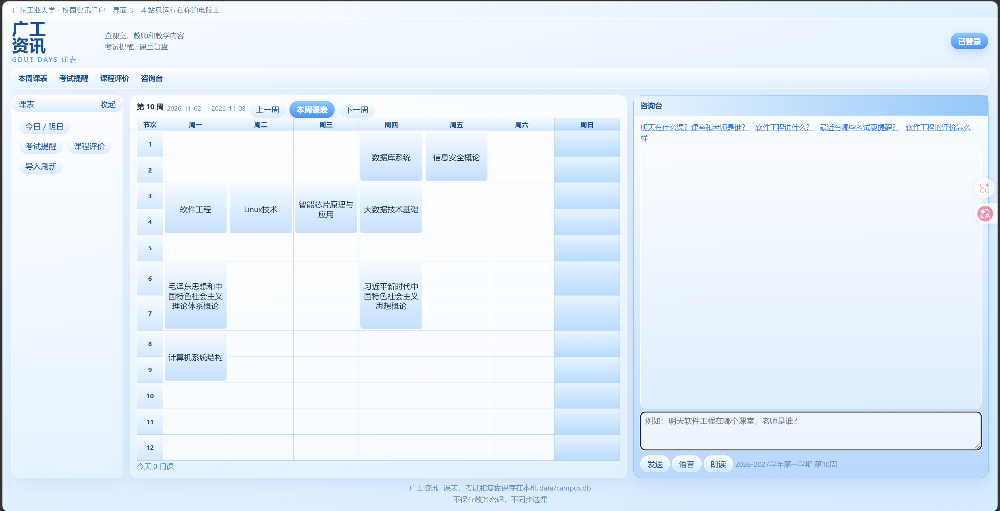
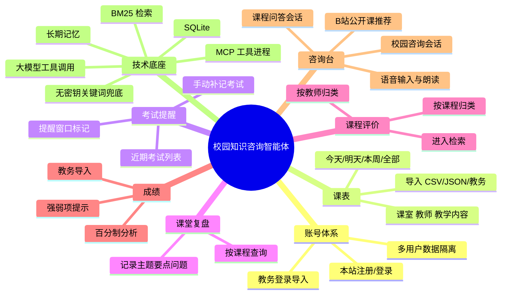
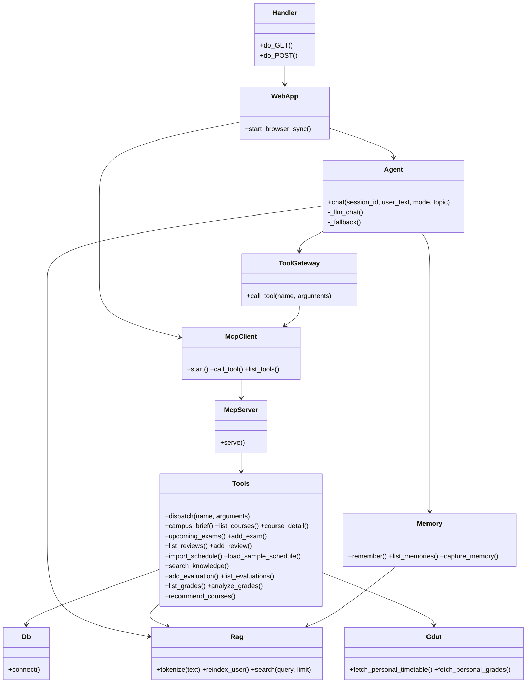
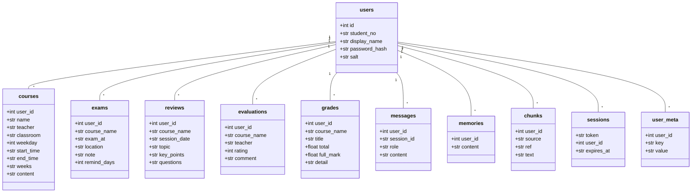

# 校园知识咨询：一个能说会做的课表智能体

| 项目 | 内容 |
| --- | --- |
| 作业所属课程 | 构建一个能说会做的智能体（广东工业大学 计算机学院 计科24级56班）<https://edu.cnblogs.com/campus/gdgy/Class56-Grade2024-CS> |
| 作业要求 | <https://edu.cnblogs.com/campus/gdgy/Class56-Grade2024-CS/homework/16760> |
| 作业的目标 | 开发一个能把智能体（大模型）真正嵌入软件系统的作品：选题要来自真实调研需求，软件要真实、可用、有价值；智能体不仅要「能说」，还要「会做」——能通过工具查询和写入真实数据；最终上线运行，供老师、助教和同学检查。我们据此做了一个面向广工学生的校园知识咨询智能体：用中文对话完成课表查询、考试提醒、课堂复盘、课程评价、成绩分析与 B 站公开课推荐，并通过 MCP 协议把工具能力嵌入网页/命令行软件，部署在公网测试机上长期运行 |
| 团队名称 | 杨富林与黎正阳的团队 |
| 团队成员 | 3124004072-杨富林、3124004060-黎正阳 |
| 源码仓库 | <https://github.com/xiersg/campus-knowledge-agent> |
| 试用地址 | <http://8.134.98.200:443/>（公网测试机，开机自启） |

## 1. 团队展示

### 1.1 队名与项目规划

**队名**：杨富林与黎正阳的团队

**项目**：校园知识咨询——面向广东工业大学学生的课表与学习智能体。

**具体规划**：

- **一句话产品**：把「查课表、记考试、复盘课堂、看成绩、找公开课」收进一个中文对话窗口，所有事实性回答必须来自工具查询的真实数据，绝不编造。
- **功能规划**：账号与教务导入 → 课表查询与看板 → 考试提醒 → 课堂复盘 → 课程评价 → 成绩导入与分析 → 课程知识问答与 B 站推荐 → 语音输入与朗读。
- **技术规划**：Python 标准库实现后端（无第三方依赖）；智能体调用 DeepSeek（OpenAI 兼容接口，可替换），未配置密钥时自动降级为关键词路由保证可用；工具以独立 MCP 进程提供，网页、命令行、外部智能体客户端共用同一套工具；数据存 SQLite，按用户隔离。
- **迭代规划**：v0.1 调研与数据底座 → v0.2 工具层与智能体 → v0.3 网页端与账号 → v1.0 测试与公网上线（详见需求分析文档的迭代记录）。
- **上线规划**：部署在公网测试机 `8.134.98.200` 的 443 端口，systemd 开机自启，长期可供老师、助教和同学试用检查。

**产品界面**（试用地址 <http://8.134.98.200:443/>）：



### 1.2 队员风采

| 项目 | 杨富林（3124004072） | 黎正阳（3124004060） |
| --- | --- | --- |
| 性格 | 沉稳细致，遇到问题喜欢追根究底 | 开朗主动，注重细节和用户体验 |
| 擅长技术 | Python、SQLite、HTTP 协议、Linux 部署 | HTML/CSS/JavaScript、接口联调、软件测试 |
| 兴趣爱好 | 写脚本把重复的事自动化，研究新工具 | 研究有意思的交互设计，逛技术社区 |
| 希望角色 | 后端 / 架构 | 前端 / 测试 |
| 本队分工 | 智能体对话循环、MCP 工具层、数据库与检索、测试机部署 | 网页前端、账号与教务接入联调、单元测试 |

### 1.3 团队合照

略

### 1.4 项目愿景

让每一位广工学生都拥有一个懂自己课表的智能体：上课前提醒课室和考试，下课后帮忙复盘要点，期末依据成绩指出复习方向。未来把更多校园数据接入对话，让查课表、问成绩、找公开课都变成一句话的事，成为同学们身边最靠谱的学习伙伴。

## 2. 需求分析文档

> 完整需求分析文档另存于仓库 `docs/需求分析文档.md`，便于上传语雀 / 腾讯文档协作。以下为全文。

### 2.0 迭代记录

| 迭代 | 时间 | 目标 | 主要内容 | 负责人 |
| --- | --- | --- | --- | --- |
| v0.1 | 2026-10-26 ～ 11-01 | 选题调研与数据底座 | 调研同学日常查课表、记考试的痛点，确定「校园知识咨询智能体」选题；设计 SQLite 数据表（用户、课表、考试、复盘、评价、成绩、对话、记忆、检索块）；实现课表解析（CSV/JSON、周次表达式、学期周换算） | 杨富林 |
| v0.2 | 2026-11-02 ～ 11-05 | 工具层与智能体 | 实现 16 个业务工具（课表、考试、复盘、评价、成绩、检索、推荐）；实现 MCP stdio 工具进程与客户端；实现 Agent 对话循环（大模型工具调用 + 无密钥关键词兜底）；长期记忆与 BM25 检索索引 | 杨富林 |
| v0.3 | 2026-11-06 ～ 11-07 | 网页端与账号 | 单页前端（课表看板、咨询台、考试提醒、课程评价、语音输入与朗读）；本站注册登录（PBKDF2 密码哈希）；教务登录导入课表与成绩、Cookie 会话保持、导入刷新；命令行入口 | 黎正阳 |
| v1.0 | 2026-11-08 | 测试与上线 | 补齐 17 项单元测试；整理示例课表与使用说明；部署到公网测试机（443 端口、systemd 开机自启）；课程问答页面挂到 `/campus/` 路径 | 杨富林、黎正阳 |

### 2.1 引言

**编写目的**：本文档描述「校园知识咨询」智能体软件的功能需求与非功能需求，作为开发、测试和课程验收的依据。参考《计算机软件需求规格说明规范》（GB/T 9385-2008）章节结构编写。

**项目背景与需求调研**：广东工业大学学生每天需要反复处理几类信息——查课表（教务系统登录繁琐，课室、教师、节次分散）、记考试（时间地点散落在各门课通知里）、复习没抓手（某次课讲了什么全凭笔记）、成绩解读（教务只给分数列表）、课程资源分散（B 站、教材、笔记来回切换）。

调研结论（面向本班与邻班同学访谈，共 11 人）：9 人表示「上课前查课室」和「考试前找时间地点」是每周都会发生的操作；8 人希望有一个统一入口把课表、考试、复盘、成绩放在一起；多数同学不排斥用自然语言对话，但要求**回答必须准确**——课室、时间、分数不能瞎编。

因此本项目不做泛泛的聊天机器人，而是一个**只回答「自己数据里的事实」的智能体**：所有课室、教师、考试时间、教学内容、成绩都必须来自工具查询结果，模型不得凭空编造。

### 2.2 项目标志与产品定位


标志含义：蓝色渐变圆角方块代表校园与知识；白色对话气泡内的课表网格代表「用对话查课表」的核心交互；右上角的闪电代表智能体「会说也会做」（对话 + 动作执行）。

**一句话定位**：面向广东工业大学学生的校园知识咨询智能体——用中文对话完成课表查询、考试提醒、课堂复盘、课程评价、成绩分析与公开课推荐。

**范围（做什么 / 不做什么）**：做课表导入与查询、考试提醒、课堂复盘、课程评价、成绩导入与分析、课程知识问答、B 站公开课推荐、多用户账号、语音输入与朗读、公网部署；不做选课抢课、不调用「日在广工」小程序接口、不保存教务密码、成绩只从教务导入不允许手记、不做移动端 App。

### 2.3 思维导图



（博客平台若不支持渲染 Mermaid，可将代码粘贴到 <https://mermaid.live> 导出图片替换。）

### 2.4 类图

**模块类图**：



**数据实体类图**：



### 2.5 功能描述

#### 2.5.1 前端功能详述

前端为**单页应用**（`campus_agent/static/index.html`，纯 HTML/CSS/JavaScript，无框架，约 1090 行），通过 `fetch` 调用后端 REST 接口。视觉风格为浅蓝渐变玻璃拟态，响应式布局（900px 以下自动改为纵向排列）。

- **页面布局**：顶部横幅（项目标志、标题、登录按钮、当前账号）；导航栏（本周课表 ｜ 考试提醒 ｜ 课程评价 ｜ 咨询台）；工作区左侧课表看板（可折叠）、右侧咨询台对话面板。
- **课表看板**：按星期（一～日）× 节次（12 节，含时间刻度）的网格展示本周课表；今天所在列高亮；支持「上一周 / 下一周」翻页；点击任一课程格子弹出课程信息窗口（时间、课室、教师、教学内容及最近一次课堂复盘）；「今日 / 明日」按钮弹出当日课表清单。
- **登录与教务导入**：本站账号注册 / 登录 / 退出弹窗；教务导入三种方式——① 本机浏览器登录（打开学校统一认证页，登录成功后自动抓取会话并导入课表与成绩）；② 粘贴教务 Cookie 导入（服务器场景）；③ 「导入刷新」用已保存的教务会话一键重新导入，无需重新登录。同步过程实时显示状态。
- **考试提醒面板**：列出近期考试/答辩（课程、时间、地点、倒计时天数），进入提醒窗口（默认提前 7 天）的条目标注「该提醒了」；展示教务导入的成绩列表；「成绩分析」按钮显示平均分、偏低课程（75 分以下）、较好课程（85 分以上）与文字结论。
- **课程评价面板**：提交表单（课程名联想、教师名联想、1～5 星评分、评语）；结果区按「按课程」「按教师」两张表归类展示。
- **咨询台**：两套会话——**校园咨询**（课表、考试、复盘、评价、成绩等一切校园事务）与**课程问答**（每门课一个独立会话，回答被限制在当前课程范围内）；课程问答模式显示课程选择标签；消息按 12 条一页分页，滚动到顶部自动加载更早记录；回答中的表格以 Markdown 风格渲染；每条回答下方显示本次调用了哪些工具（工具名 + 是否成功），保证「说出来的话有据可查」；支持**浏览器语音输入**（Web Speech API）与**朗读最近一条回答**。

前端不直接读写数据库，全部通过 REST 接口；登录状态由 HttpOnly Cookie 自动携带；接口统一返回 `{"ok": true/false, ...}` 结构。

#### 2.5.2 后端功能详述

后端为 Python 3.10+ 标准库实现（无第三方依赖）：

- **智能体对话循环（agent.py）**：接收用户消息与模式（校园咨询 / 课程问答）→ 保存消息、捕获长期记忆触发词 → 有模型密钥时，把系统提示（含当前时间、教学周、长期记忆、检索命中上下文）与最近 8 条历史（约 6000 字上限）发给模型，模型可在最多 5 轮内选择调用工具，每次工具调用的 JSON 结果回填给模型，最终回答缺表格时自动补上工具生成的 Markdown 表格；无密钥或接口失败时，按中文关键词路由直接调用工具（如「明天」→ 查明天课表），核心功能离线可用且绝不编造课室与分数；超长会话自动折叠（同一会话超过 36 条时，最早的原文压缩成一条长期记忆后删除，保留最近 18 条）。课程问答模式的系统提示把回答锁定在当前课程，检索、复盘和 B 站推荐都围绕该课程，避免串课。
- **工具层（tools.py，16 个工具）**：

| 工具 | 功能 | 写操作 |
| --- | --- | --- |
| `campus_brief` | 今日/明日课表摘要 + 应提醒的考试 + 当前教学周 | 否 |
| `list_courses` | 按今天/明天/教学周/全部列课，可按关键词过滤、翻周 | 否 |
| `course_detail` | 某门课的教师、课室、时间、教学内容 + 最近复盘 | 否 |
| `upcoming_exams` | 未来 N 天考试，标注是否进入提醒窗口 | 否 |
| `add_exam` | 新增考试/答辩提醒（时间、地点、提前提醒天数） | 是 |
| `list_reviews` / `add_review` | 查看 / 记录课堂复盘（主题、要点、遗留问题） | add 是 |
| `import_schedule` | 导入 CSV 或 JSON 课表（可含考试、复盘） | 是 |
| `load_sample_schedule` | 载入示例课表 | 是 |
| `search_knowledge` | 在课表、考试、复盘、评价、成绩、记忆的索引中检索 | 否 |
| `add_evaluation` / `list_evaluations` | 记录 / 查看课程评价（按课程、按教师归类） | add 是 |
| `list_grades` / `analyze_grades` | 查看成绩 / 百分制分析（平均分、弱项、强项） | 否 |
| `recommend_courses` | 按主题搜 B 站视频，返回标题、UP 主、播放量、链接 | 否 |

约束：成绩只能由教务导入写入（来源标记 `_source=jxfw`），再次导入只替换教务来源记录；对话与网页不提供手记成绩入口；所有工具做参数校验，失败返回 `{"ok": false, "error": ...}`，智能体如实说明失败原因。

- **MCP 工具服务（mcp_server.py / mcp_client.py）**：工具以独立进程提供，遵循 MCP（2024-11-05）stdio 传输（Content-Length 帧 + JSON-RPC 2.0），支持 `initialize`、`ping`、`tools/list`、`tools/call`；网页与命令行共用同一个 MCP 客户端，调用时附加 `user_id` 实现多用户隔离；工具清单即 `TOOL_SPECS`，一份定义同时作为模型工具声明与 `tools/list` 返回内容。
- **数据与安全**：SQLite（WAL），12 张表；账号数据全部按 `user_id` 隔离，示例账号不能密码登录；密码 PBKDF2-HMAC-SHA256 12 万次迭代 + 随机盐；会话 Cookie `campus_session` HttpOnly、SameSite=Lax、14 天；教务 Cookie 只存服务端用于「导入刷新」，接口响应一律不返回，教务密码不保存；请求体上限 1 MB，JSON 严格校验。
- **教务与外部接口**：课表走教务个人课表（统一认证 authserver.gdut.edu.cn），解析节次时间表（12 节）、周次表达式（`1-16`、`1-8,10`、`1-16单`）、教师、课室、教学内容；成绩走教务成绩接口（总评、平时、期中、期末、学分、绩点与分项分数）；B 站公开搜索页解析推荐视频，无结果时返回搜索页链接兜底。
- **检索与记忆**：BM25 索引（中文单字 + 相邻双字切词，英文数字整段切词），课表、考试、复盘、评价、成绩、记忆全部进入索引，写操作后自动重建；长期记忆由触发词（记住 / 请记得 / 别忘了 / 以后都 / 我喜欢 / 我不喜欢）捕获，最多 30 条。
- **命令行入口（cli.py）**：`python -m campus_agent.cli --demo` 在终端与智能体对话，与网页共用同一套 Agent 与工具。

### 2.6 接口需求

**REST 接口**：

| 方法 | 路径 | 用途 | 认证 |
| --- | --- | --- | --- |
| GET | `/` | 返回单页前端 | 无 |
| GET | `/api/health` | 健康检查（是否配置了模型密钥） | 无 |
| GET | `/api/me` | 当前登录用户信息 | 会话 |
| POST | `/api/register` `/api/login` `/api/logout` | 注册 / 登录 / 退出 | 无 / 会话 |
| GET | `/api/overview` | 今日简报（今天明天的课 + 提醒） | 会话 |
| GET | `/api/week?offset=n` | 按教学周取课表（offset 翻周） | 会话 |
| GET | `/api/messages?session_id=&before=&limit=` | 分页取会话消息 | 会话 |
| POST | `/api/chat` | 对话（message、mode、topic、session_id） | 会话 |
| POST | `/api/import` | 导入 CSV/JSON 课表 | 会话 |
| POST | `/api/sample` | 载入示例课表 | 会话 |
| POST | `/api/gdut-sync` | 用粘贴的教务 Cookie 导入课表+成绩 | 会话 |
| POST | `/api/gdut-refresh` | 用已保存的教务会话刷新导入 | 会话 |
| POST | `/api/gdut-browser-sync` | 本机浏览器登录导入（轮询 GET 取状态） | 会话 |
| GET | `/api/grades?keyword=` | 成绩列表 | 会话 |
| GET | `/api/grade-analysis` | 成绩百分制分析 | 会话 |
| GET/POST | `/api/evaluations` | 评价列表 / 提交评价 | 会话 |

**MCP 接口**：stdio 传输（Content-Length 帧 + JSON-RPC 2.0），协议版本 2024-11-05；方法 `initialize`、`ping`、`tools/list`（返回 16 个工具的 JSON Schema）、`tools/call`；调用时由客户端注入 `user_id`，服务端按当前用户执行。

### 2.7 非功能需求

| 类别 | 需求 |
| --- | --- |
| 性能 | 单机可支撑一个班级规模的并发使用；对话历史裁剪保证单次模型请求 ≤ 约 12000 字；消息分页每页 12 条；SQLite WAL 读写不阻塞 |
| 安全 | 密码只存 PBKDF2 哈希；会话 Cookie HttpOnly 14 天；教务 Cookie 不出接口；多用户数据严格隔离；SQL 全部参数化 |
| 可靠 | 模型接口不可用时自动降级为关键词路由，核心查询仍可用；工具失败如实说明；systemd `Restart=always` 崩溃自愈 |
| 可用 | 全中文交互；未配置模型密钥也可演示全部功能；浏览器语音输入与朗读；内置示例课表一键体验 |
| 可维护 | 仅用 Python 标准库；网页、命令行、MCP 共用同一套工具层；17 项单元测试 |

### 2.8 验收标准

> 说明：验收标准只覆盖 v1.0 已实现并部署的能力，不包含任何规划中但未实现的功能。

| 编号 | 验收项 | 验收标准 | 验证方式 |
| --- | --- | --- | --- |
| A1 | 账号体系 | 可注册、登录、退出；密码不存明文；14 天内会话保持 | 手工 + `test_accounts_do_not_share_schedules` |
| A2 | 课表导入 | 粘贴 CSV 或 JSON 课表后返回导入课程数；示例课表一键载入 | 手工 + `test_exam_reminder_and_import` |
| A3 | 教务接入 | 浏览器登录或粘贴 Cookie 后自动导入个人课表与成绩；「导入刷新」用已保存会话重导 | 手工（本机）/ Cookie 模式（服务器） |
| A4 | 课表查询 | 问「明天有什么课」返回日期、时间、课程、教师、课室、教学内容表格；本周看板按星期×节次展示且可翻周；点课程弹详情 | 手工 + `test_week_page_turns` |
| A5 | 考试提醒 | 列出未来 45 天内考试，进入提醒窗口（≤ remind_days）的条目标注「该提醒了」；可添加考试 | 手工 + `test_exam_reminder_and_import` |
| A6 | 课堂复盘 | 可记录并查询复盘（主题、要点、问题）；课程详情附最近复盘 | 手工 + `test_record_review_roundtrip` |
| A7 | 课程评价 | 提交 1～5 分评价；列表按课程、按教师两张表归类；评价可被检索 | 手工 + `test_evaluations_group_and_search` |
| A8 | 成绩 | 教务导入后显示成绩列表；百分制分析给出平均分、75 分以下弱项、85 分以上强项与结论；系统拒绝手记成绩 | 手工 + `test_school_grades_replace_only_official_rows` |
| A9 | 课程问答 | 每门课独立会话；回答限定在当前课程；优先引用本机教学内容与复盘；本机无材料时给出 B 站推荐（标题+链接） | 手工 + `test_grade_analysis_and_bilibili_session` |
| A10 | 无密钥兜底 | 不配置模型密钥时，查询类问题仍能由工具直接回答，且不编造课室与分数 | 手工（清空 `.env` 重启） |
| A11 | 语音 | 浏览器支持时可用语音输入问题、朗读最近一条回答 | 手工（Chrome/Edge） |
| A12 | 多用户隔离 | 不同账号的课表、对话、评价互不可见 | `test_accounts_do_not_share_schedules` |
| A13 | 上线运行 | `http://8.134.98.200:443/` 公网可访问；服务器重启后服务自动恢复（systemd enabled） | 手工 + 部署检查 |
| A14 | 自动化测试 | `python -m unittest discover -s tests -v` 17 项测试全部通过 | 命令行 |

## 3. 怎么运行

```powershell
cd D:\code\campus-knowledge-agent
python -m campus_agent
python -m unittest discover -s tests -v
```

浏览器打开 <http://127.0.0.1:8765>。复制 `.env.example` 为 `.env` 填模型密钥（`OPENAI_API_KEY`、`OPENAI_BASE_URL`、`OPENAI_MODEL`），接口兼容 OpenAI Chat Completions；没有密钥时仍按问题调用真实工具回答，不会编造课室和分数。

示例问法：

- 明天有什么课？课室和老师是谁？
- 软件工程讲什么？
- 最近有哪些考试要提醒？
- 分析一下我的成绩
- 在「课程问答」里选中一门课后：这门课在讲什么？推荐一门公开课

## 4. 小组分工与小结

**分工**：杨富林负责智能体对话循环（agent.py）、MCP 工具层与服务进程（tools.py / mcp_server.py / mcp_client.py）、数据库与检索（db.py / rag.py / memory.py）、教务接口（gdut.py）、测试机部署（deploy/ 与 systemd）；黎正阳负责网页前端（static/index.html）、HTTP 服务与账号接入（web.py / accounts.py / browser_login.py）、单元测试（tests/）。

**小结**：这次实现里，课室、教师、考试时间、教学内容、复盘要点和成绩都只从工具结果来——模型没有返回工具调用时，不会把猜测当成课表。智能体既嵌入了网页（咨询台）也嵌入了命令行，工具通过 MCP 独立进程暴露，外部智能体客户端同样可以接入。系统已经部署在公网测试机上并设为开机自启，老师和助教可以随时访问 <http://8.134.98.200:443/> 试用检查。
