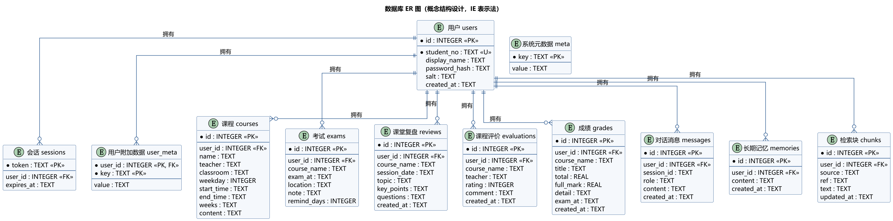
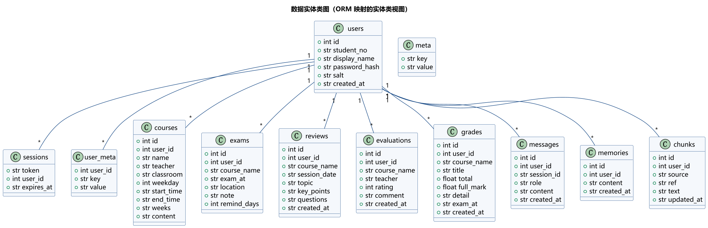

# 1. 引言

## 1.1 编写目的

本文档描述校园知识咨询智能体数据库（SQLite 单文件 data/campus.db）的设计，包括外部设计、概念结构设计（ER 模型）、逻辑结构设计（关系模式、范式、索引、对象关系映射）、物理结构设计（存储与访问方式）和运用设计（数据字典、安全保密、一致性），作为数据库实现、测试、部署与课程验收的依据。本文档依据 GB/T 8567-2006《计算机软件文档编制规范》中《数据库（顶层）设计说明（DBDD）》的文档框架编写。

## 1.2 背景

校园知识咨询智能体面向广东工业大学学生，提供课表查询、考试提醒、课堂复盘、课程评价、成绩分析与课程知识问答等能力。数据库是系统唯一的事实来源：所有课室、教师、考试时间、教学内容与成绩均由数据库（或经教务接口写入数据库）提供，模型不得凭空编造。系统为多用户应用，全部业务数据按 user_id 隔离；检索索引与长期记忆也存储在库中。数据库设计文档与《杨富林与黎正阳的团队_系统设计说明书》配套，后者第 4.5 节、第 6 章从系统视角描述数据访问层。

## 1.3 定义与缩写

| 缩写/术语 | 定义 |
| --- | --- |
| DB | Database，数据库；本文指 SQLite 单文件 data/campus.db |
| DBMS | 数据库管理系统；本文指 SQLite 3.x（Python 内置 sqlite3 模块访问） |
| ER 模型 | Entity-Relationship Model，实体-联系模型，用于概念结构设计 |
| 关系模式 | 用关系（二维表）描述数据逻辑结构的模式；本文共 12 个 |
| PK / FK | Primary Key 主键 / Foreign Key 外键 |
| 3NF | 第三范式；关系模式满足的规范化等级 |
| ORM | Object-Relational Mapping，对象关系映射；本系统不使用 ORM 框架，实体与库表的映射方式见 4.4 节 |
| WAL | Write-Ahead Logging，SQLite 预写日志模式 |
| BM25 | 全文检索排序算法；检索索引存于 chunks 表 |
| ISO 8601 | 日期时间文本格式标准；本库时间字段一律采用该格式 |
| SQL | 结构化查询语言；本库全部 SQL 参数化执行 |

其余术语（MCP、PBKDF2、CSV 等）见《系统设计说明书》1.4 节。

## 1.4 参考资料

- GB/T 8567-2006《计算机软件文档编制规范》；
- 《杨富林与黎正阳的团队_系统设计说明书》v1.0；
- 《杨富林与黎正阳的团队_需求分析文档》v1.0（本仓库 docs/需求分析文档.md）；
- SQLite 官方文档（WAL、类型亲和、事务）；
- 项目源码：https://github.com/xiersg/campus-knowledge-agent 。

# 2. 外部设计

## 2.1 标识符和状态

| 项目 | 内容 |
| --- | --- |
| 数据库名称 | campus.db |
| 数据库版本 | v1.0（随系统 v1.0，2026-11-08） |
| 文件位置 | 测试机 /opt/campus-knowledge-agent/data/campus.db；本机 项目目录/data/campus.db |
| 数据库状态 | 已投入使用（公网测试机长期运行，开机自启） |
| 模式数量 | 12 张表（SCHEMA 幂等建表，老库自动 ALTER 补列迁移） |
| 兼容性 | SQLite 3.x（Python 3.10+ 内置 sqlite3）；WAL 模式 |

## 2.2 使用它的程序

数据库为系统内唯一数据源，访问矩阵如下（✔ 表示该模块直接读写该表）：

| 表 | web.py | agent.py | tools.py | rag.py | memory.py | accounts.py |
| --- | --- | --- | --- | --- | --- | --- |
| meta | ✔ | | ✔ | | | |
| users | ✔ | | | | | ✔ |
| sessions | ✔ | | | | | ✔ |
| user_meta | ✔ | ✔ | ✔ | | | |
| courses | | ✔ | ✔ | ✔ | | |
| exams | | ✔ | ✔ | ✔ | | |
| reviews | | ✔ | ✔ | ✔ | | |
| evaluations | | ✔ | ✔ | ✔ | | |
| grades | | ✔ | ✔ | ✔ | | |
| messages | ✔ | ✔ | | | | |
| memories | | | | ✔ | ✔ | |
| chunks | | | | ✔ | | |

约束：工具层与数据层之间只有上表所列模块持有数据库连接；其余模块（gdut.py、bilibili.py、schedule.py、browser_login.py、mcp_server.py 等）不得直接访问数据库。

## 2.3 约定

| 类别 | 约定 |
| --- | --- |
| 命名 | 表名小写英文复数；字段名小写 snake_case；主键统一 id（sessions 用 token，user_meta 用联合主键，meta 用 key） |
| 时间格式 | 一律 ISO 8601 文本：日期 YYYY-MM-DD、时间 HH:MM、日期时间 YYYY-MM-DD HH:MM；由 config.py 的 now_local/today 统一生成 |
| 周次表达式 | courses.weeks 存紧凑表达式：1-16、1-8,10、1-16单；解析展开见 schedule.py:parse_weeks |
| 学期代码 | 202601 表示 2026-2027 学年第一学期；学期起始日存 meta/user_meta 的 semester_start |
| 星期 | courses.weekday 为整数 1～7（1=周一） |
| 评分 | evaluations.rating 为整数 1～5 |
| 角色 | messages.role 取值 user / assistant |
| 会话编号 | messages.session_id：校园咨询为 campus:<n>，课程问答为 course:<课程名>:<n> |
| 检索来源 | chunks.source 取值 courses / exams / reviews / evaluations / grades / memories |
| 成绩来源 | grades 中教务导入的记录 title/detail 含来源标记（_source=jxfw），再次导入只替换教务来源记录 |
| 密码 | 只存 PBKDF2-HMAC-SHA256 哈希（password_hash）与随机盐（salt），不存明文 |
| SQL | 全部参数化（? 占位符），禁止字符串拼接 |

## 2.4 支持软件

| 项目 | 说明 |
| --- | --- |
| DBMS | SQLite 3.x（Python 标准库 sqlite3，无需安装）；连接参数 timeout=10、check_same_thread=False（多线程服务共享连接） |
| 运行模式 | PRAGMA journal_mode=WAL（读写不互斥）；PRAGMA foreign_keys=ON |
| 工具 | 无外部数据库工具；备份用文件复制；调试可用 sqlite3 命令行 |
| 运行环境 | Linux 测试机（systemd）、用户本机 Windows/macOS |

# 3. 概念结构设计

## 3.1 实体识别与说明

从需求分析抽象出 12 个实体（1 个系统级、1 个账号级、10 个用户业务级）：

| 实体 | 说明 | 主要属性 |
| --- | --- | --- |
| 用户（users） | 本站注册账号；示例账号 id=1 供访客体验 | 学号、显示名、密码哈希、盐 |
| 会话（sessions） | 用户登录后签发的会话令牌 | 令牌、过期时间 |
| 用户附加数据（user_meta） | 每用户的键值对配置（教务 Cookie、学期设置、折叠进度） | 键、值 |
| 课程（courses） | 用户课表中的一门课（按上课时段一行） | 课程名、教师、课室、星期、起止时间、周次、教学内容 |
| 考试（exams） | 一场考试或答辩提醒 | 课程名、考试时间、地点、备注、提前提醒天数 |
| 课堂复盘（reviews） | 对某一次课堂的记录 | 课程名、日期、主题、要点、遗留问题 |
| 课程评价（evaluations） | 对课程/教师的评分与评语 | 课程名、教师、评分、评语 |
| 成绩（grades） | 某门课的一项成绩（总评/平时/期中/期末/学分/绩点） | 课程名、条目名、得分、满分、分项明细 |
| 对话消息（messages） | 咨询台对话的一条消息 | 会话编号、角色、内容 |
| 长期记忆（memories） | 从用户话语捕获的长期记忆 | 内容 |
| 检索块（chunks） | BM25 索引的一条记录（源行内容的副本） | 来源、源引用、正文 |
| 系统元数据（meta） | 系统级配置（学期起始、学期名） | 键、值 |

## 3.2 实体-联系模型（ER 图）

联系说明：

| 联系 | 类型 | 说明 |
| --- | --- | --- |
| 用户—会话 | 1 : N | 一个用户可有多个会话令牌（多设备登录）；令牌过期后失效 |
| 用户—用户附加数据 | 1 : N | 一个用户有多条键值对；键值对依赖用户存在 |
| 用户—课程 | 1 : N | 一个用户一学期约几十门课（按上课时段计） |
| 用户—考试 | 1 : N | 一个用户多场考试/答辩 |
| 用户—课堂复盘 | 1 : N | 一个用户多次复盘记录 |
| 用户—课程评价 | 1 : N | 一个用户多条评价 |
| 用户—成绩 | 1 : N | 一个用户多门课的成绩条目 |
| 用户—对话消息 | 1 : N | 一个用户多条消息；消息按 session_id 归组会话 |
| 用户—长期记忆 | 1 : N | 一个用户最多 30 条记忆 |
| 用户—检索块 | 1 : N | 检索块是按用户重建的索引，随源数据写操作重建 |
| 系统元数据 | 独立 | 与用户无关的系统级配置 |

派生联系：检索块（chunks）由课程、考试、复盘、评价、成绩、记忆六个实体派生（写操作后重建），在 ER 图中体现为用户—检索块的 1:N 关系，其内容冗余自源实体。

## 3.3 概念级数据字典

| 实体 | 属性清单 |
| --- | --- |
| 用户 | id、student_no（学号）、display_name（显示名）、password_hash（密码哈希）、salt（盐）、created_at（创建时间） |
| 会话 | token（令牌）、user_id、expires_at（过期时间） |
| 用户附加数据 | user_id、key（键）、value（值） |
| 课程 | id、user_id、name（课程名）、teacher（教师）、classroom（课室）、weekday（星期）、start_time（开始时间）、end_time（结束时间）、weeks（周次）、content（教学内容） |
| 考试 | id、user_id、course_name、exam_at（考试时间）、location（地点）、note（备注）、remind_days（提前提醒天数） |
| 课堂复盘 | id、user_id、course_name、session_date（上课日期）、topic（主题）、key_points（要点）、questions（遗留问题）、created_at |
| 课程评价 | id、user_id、course_name、teacher、rating（1～5 分）、comment（评语）、created_at |
| 成绩 | id、user_id、course_name、title（条目名）、total（得分）、full_mark（满分）、detail（分项明细）、exam_at（考试时间）、created_at |
| 对话消息 | id、user_id、session_id（会话编号）、role（角色）、content（内容）、created_at |
| 长期记忆 | id、user_id、content、created_at |
| 检索块 | id、user_id、source（来源）、ref（源引用）、text（正文）、updated_at |
| 系统元数据 | key、value |

# 4. 逻辑结构设计

## 4.1 关系模式设计

共 12 个关系模式（SQLite DDL 见源码 db.py:SCHEMA；下表按「字段：类型 约束」列出）：

**R1 users（用户）**

| 字段 | 类型 | 约束 |
| --- | --- | --- |
| id | INTEGER | PRIMARY KEY（自增） |
| student_no | TEXT | NOT NULL、UNIQUE（学号唯一） |
| display_name | TEXT | NOT NULL |
| password_hash | TEXT | NOT NULL（PBKDF2 哈希，不存明文） |
| salt | TEXT | NOT NULL（随机盐） |
| created_at | TEXT | NOT NULL（ISO 8601） |

**R2 sessions（会话）**

| 字段 | 类型 | 约束 |
| --- | --- | --- |
| token | TEXT | PRIMARY KEY（128 位随机令牌） |
| user_id | INTEGER | NOT NULL（关联 users.id） |
| expires_at | TEXT | NOT NULL（签发时间 + 14 天） |

**R3 user_meta（用户附加数据）**

| 字段 | 类型 | 约束 |
| --- | --- | --- |
| user_id | INTEGER | PRIMARY KEY 之一（关联 users.id） |
| key | TEXT | PRIMARY KEY 之一 |
| value | TEXT | NOT NULL |

**R4 courses（课程）**

| 字段 | 类型 | 约束 |
| --- | --- | --- |
| id | INTEGER | PRIMARY KEY |
| user_id | INTEGER | NOT NULL DEFAULT 1（关联 users.id） |
| name | TEXT | NOT NULL（课程名） |
| teacher | TEXT | NOT NULL |
| classroom | TEXT | NOT NULL |
| weekday | INTEGER | NOT NULL（1～7） |
| start_time | TEXT | NOT NULL（HH:MM） |
| end_time | TEXT | NOT NULL（HH:MM） |
| weeks | TEXT | NOT NULL（周次表达式） |
| content | TEXT | NOT NULL DEFAULT ''（教学内容） |

**R5 exams（考试）**

| 字段 | 类型 | 约束 |
| --- | --- | --- |
| id | INTEGER | PRIMARY KEY |
| user_id | INTEGER | NOT NULL DEFAULT 1 |
| course_name | TEXT | NOT NULL |
| exam_at | TEXT | NOT NULL（YYYY-MM-DD HH:MM） |
| location | TEXT | NOT NULL |
| note | TEXT | NOT NULL DEFAULT '' |
| remind_days | INTEGER | NOT NULL DEFAULT 7（提前提醒天数） |

**R6 reviews（课堂复盘）**

| 字段 | 类型 | 约束 |
| --- | --- | --- |
| id | INTEGER | PRIMARY KEY |
| user_id | INTEGER | NOT NULL DEFAULT 1 |
| course_name | TEXT | NOT NULL |
| session_date | TEXT | NOT NULL（YYYY-MM-DD） |
| topic | TEXT | NOT NULL（主题） |
| key_points | TEXT | NOT NULL（要点） |
| questions | TEXT | NOT NULL DEFAULT ''（遗留问题） |
| created_at | TEXT | NOT NULL |

**R7 evaluations（课程评价）**

| 字段 | 类型 | 约束 |
| --- | --- | --- |
| id | INTEGER | PRIMARY KEY |
| user_id | INTEGER | NOT NULL |
| course_name | TEXT | NOT NULL |
| teacher | TEXT | NOT NULL |
| rating | INTEGER | NOT NULL（1～5） |
| comment | TEXT | NOT NULL DEFAULT '' |
| created_at | TEXT | NOT NULL |

**R8 grades（成绩）**

| 字段 | 类型 | 约束 |
| --- | --- | --- |
| id | INTEGER | PRIMARY KEY |
| user_id | INTEGER | NOT NULL |
| course_name | TEXT | NOT NULL |
| title | TEXT | NOT NULL（总评/平时/期中/期末/学分/绩点） |
| total | REAL | NOT NULL（得分；学分/绩点条目亦存于此） |
| full_mark | REAL | NOT NULL DEFAULT 100 |
| detail | TEXT | NOT NULL DEFAULT ''（分项分数，JSON 文本） |
| exam_at | TEXT | NOT NULL DEFAULT '' |
| created_at | TEXT | NOT NULL |

**R9 messages（对话消息）**

| 字段 | 类型 | 约束 |
| --- | --- | --- |
| id | INTEGER | PRIMARY KEY |
| user_id | INTEGER | NOT NULL DEFAULT 1 |
| session_id | TEXT | NOT NULL（campus:<n> / course:<课程名>:<n>） |
| role | TEXT | NOT NULL（user / assistant） |
| content | TEXT | NOT NULL |
| created_at | TEXT | NOT NULL |

**R10 memories（长期记忆）**

| 字段 | 类型 | 约束 |
| --- | --- | --- |
| id | INTEGER | PRIMARY KEY |
| user_id | INTEGER | NOT NULL |
| content | TEXT | NOT NULL |
| created_at | TEXT | NOT NULL |

**R11 chunks（检索块）**

| 字段 | 类型 | 约束 |
| --- | --- | --- |
| id | INTEGER | PRIMARY KEY |
| user_id | INTEGER | NOT NULL |
| source | TEXT | NOT NULL（courses/exams/reviews/evaluations/grades/memories） |
| ref | TEXT | NOT NULL（源行 id 或引用说明） |
| text | TEXT | NOT NULL（正文副本） |
| updated_at | TEXT | NOT NULL |

**R12 meta（系统元数据）**

| 字段 | 类型 | 约束 |
| --- | --- | --- |
| key | TEXT | PRIMARY KEY |
| value | TEXT | NOT NULL |

## 4.2 范式分析

各关系模式均满足 3NF：

| 模式 | 分析 |
| --- | --- |
| users | 非主属性只依赖主键 id；student_no 为候选键且唯一约束保证无部分依赖 |
| sessions / user_meta | 主键（token / user_id+key）决定全部非主属性，无传递依赖 |
| courses / exams / reviews / evaluations / grades / messages / memories / chunks | 每个业务属性都直接描述该实体本身（如教师、课室描述课程），不存在「A→B→C」的传递依赖；user_id 是外键语义而非属性依赖 |
| meta | 键值对模式，主键 key 决定 value |

未做反规范化（冗余）设计：单用户数据量小（课程数十行、消息数千行），3NF 的多表连接开销可忽略；检索性能由 chunks 表（本身就是受控冗余）解决。grades.detail 以 JSON 文本存分项分数，属于对教务接口数据的原样留存，不影响范式（该字段整体视为一个属性）。

## 4.3 索引设计

| 索引 | 说明 |
| --- | --- |
| PRIMARY KEY | 各表主键（SQLite rowid 隐含索引，无需额外存储） |
| UNIQUE(student_no) | users 学号唯一约束（隐式唯一索引） |
| UNIQUE(user_id, key) | user_meta 联合主键（隐式唯一索引） |
| 未建 user_id 二级索引 | 业务查询均按 user_id 等值过滤；单用户数据量小（数千行），全表扫描毫秒级，故暂不建二级索引；如未来单用户数据量增长，可对 courses/exams/messages/chunks 的 user_id 加索引 |
| 检索索引 | BM25 索引不经 SQLite 索引机制，而由 rag.py 在内存中按用户构建（chunks 表为索引的持久化形态） |

## 4.4 对象关系映射（ORM）

本系统受「仅用标准库」约束，不引入 ORM 框架；实体与库表的映射由代码约定保证：数据访问层统一用 sqlite3.Row 读取、rows_as_dicts 转为 dict，字段名即列名。实体类视图如下：

映射关系表：

| 库表 | Python 表示 | 读写模块 | 说明 |
| --- | --- | --- | --- |
| users | dict（sqlite3.Row → dict） | accounts.py、web.py | 注册/登录/会话还原 |
| sessions | dict | accounts.py | 签发/校验/删除 |
| user_meta | dict | web.py、tools.py、agent.py | 键值对；键：jxfw_cookie、semester_start、semester_name、对话折叠进度键 |
| courses | dict | tools.py、rag.py、agent.py | 工具层读写，检索层建索引 |
| exams | dict | tools.py、rag.py | 同上 |
| reviews | dict | tools.py、rag.py | 同上 |
| evaluations | dict | tools.py、rag.py | 同上 |
| grades | dict | tools.py、rag.py | 同上（仅教务导入写入） |
| messages | dict | agent.py、web.py | 对话分页与折叠 |
| memories | dict | memory.py、rag.py | 上限 30 条 |
| chunks | dict | rag.py | 索引持久化，写操作后重建 |
| meta | dict | db.py、tools.py | 系统级学期配置 |

映射约定：字段名与列名一一对应（snake_case）；时间字段在 Python 侧为 str（ISO 8601）；rating、weekday、remind_days 在 Python 侧为 int；total、full_mark 为 float；工具层与网页层之间以 JSON 对象传递实体（TOOL_SPECS 定义的返回结构即实体在接口层的形态）。

# 5. 物理结构设计

## 5.1 存储结构

| 项目 | 设计 |
| --- | --- |
| 存储介质 | 测试机磁盘单文件（/opt/campus-knowledge-agent/data/campus.db） |
| 文件格式 | SQLite 数据库文件 + WAL 文件（-wal）与共享内存文件（-shm） |
| 日志模式 | WAL：写事务追加到 -wal，读不阻塞写 |
| 页大小 | SQLite 默认 4096 字节（数据量小，无需调整） |
| 自动清理 | WAL 在 checkpoint 后回收；数据库定期由正常关闭触发 checkpoint |

## 5.2 访问方式

| 项目 | 设计 |
| --- | --- |
| 连接管理 | 每模块按需 connect()，短生命周期；连接共享参数 check_same_thread=False（HTTP 多线程环境）；timeout=10 秒等待写锁 |
| 事务 | 写操作显式 conn.commit()；多语句写操作（如导入课表：先 DELETE 再批量 INSERT）在同一事务内完成 |
| 查询模式 | 一律 WHERE user_id = ? 隔离；分页用 LIMIT/OFFSET；列表按需 keyword LIKE 过滤 |
| 并发 | 多线程 + WAL：读并发无锁，写串行由 SQLite 锁管理 |

## 5.3 数据量与性能估算

| 对象 | 估算 | 说明 |
| --- | --- | --- |
| 用户 | 班级规模（数十） | 学号唯一约束 |
| 课程 | 每用户每学期约 20～60 行 | 按上课时段计 |
| 对话消息 | 每活跃用户数千行 | 折叠机制控制会话长度，删除旧原文 |
| 检索块 | 每用户数千行 | 随源数据写操作重建 |
| 全库规模 | 十万行以内 | SQLite 与 BM25 内存索引均无压力；重建索引毫秒级 |

## 5.4 备份与恢复

| 项目 | 设计 |
| --- | --- |
| 备份 | 文件级备份：停止服务（或 WAL checkpoint 后）复制 campus.db；WAL 模式下直接复制 campus.db + -wal + -shm 亦可用 |
| 恢复 | 用备份文件替换数据目录后重启服务 |
| 迁移 | SCHEMA 用 CREATE TABLE IF NOT EXISTS 幂等建表；connect() 时 PRAGMA table_info 检查关键列（如 user_id），缺列自动 ALTER TABLE ADD COLUMN 补列，老库平滑升级 |
| 初始化 | 首次启动自动创建示例账号（id=1）与学期元数据（semester_start、semester_name），保证开箱可用 |

# 6. 运用设计

## 6.1 数据字典

### 6.1.1 users（用户）

| 字段 | 类型 | 说明 | 示例 |
| --- | --- | --- | --- |
| id | INTEGER | 主键，自增 | 1 |
| student_no | TEXT | 学号，唯一；示例账号为 sample | 3124004072 |
| display_name | TEXT | 显示名 | 杨富林 |
| password_hash | TEXT | PBKDF2-HMAC-SHA256 哈希（120000 次迭代） | pbkdf2$... |
| salt | TEXT | 随机盐（16 字节 hex） | 3f8a... |
| created_at | TEXT | 注册时间 | 2026-11-08 10:23:45 |

### 6.1.2 sessions（会话）

| 字段 | 类型 | 说明 | 示例 |
| --- | --- | --- | --- |
| token | TEXT | 主键，128 位随机令牌 | 9c2d... |
| user_id | INTEGER | 所属用户 | 3 |
| expires_at | TEXT | 过期时间（签发 + 14 天） | 2026-12-06 10:23:45 |

### 6.1.3 user_meta（用户附加数据）

| 键 | value 说明 |
| --- | --- |
| jxfw_cookie | 教务会话 Cookie，仅服务端读取用于「导入刷新」，任何接口不返回 |
| semester_start | 该用户学期起始日（覆盖系统默认） |
| semester_name | 该用户学期名称（覆盖系统默认） |
| 对话折叠进度键 | 记录各会话已折叠到的消息 id，避免重复压缩 |

### 6.1.4 courses（课程）

| 字段 | 类型 | 说明 | 示例 |
| --- | --- | --- | --- |
| id | INTEGER | 主键 | 12 |
| user_id | INTEGER | 所属用户 | 3 |
| name | TEXT | 课程名 | 软件工程 |
| teacher | TEXT | 教师 | 张三 |
| classroom | TEXT | 课室 | 教1-305 |
| weekday | INTEGER | 星期 1～7 | 1 |
| start_time | TEXT | 开始时间 HH:MM | 08:30 |
| end_time | TEXT | 结束时间 HH:MM | 10:05 |
| weeks | TEXT | 周次表达式 | 1-16 |
| content | TEXT | 教学内容 | 需求分析、UML 建模 |

### 6.1.5 exams（考试）

| 字段 | 类型 | 说明 | 示例 |
| --- | --- | --- | --- |
| id | INTEGER | 主键 | 5 |
| user_id | INTEGER | 所属用户 | 3 |
| course_name | TEXT | 课程名 | 软件工程 |
| exam_at | TEXT | 考试时间 | 2026-12-28 09:00 |
| location | TEXT | 地点 | 教2-201 |
| note | TEXT | 备注 | 闭卷 |
| remind_days | INTEGER | 提前几天进入提醒窗口 | 7 |

### 6.1.6 reviews（课堂复盘）

| 字段 | 类型 | 说明 | 示例 |
| --- | --- | --- | --- |
| id | INTEGER | 主键 | 8 |
| user_id | INTEGER | 所属用户 | 3 |
| course_name | TEXT | 课程名 | 软件工程 |
| session_date | TEXT | 上课日期 | 2026-11-16 |
| topic | TEXT | 主题 | 概要设计 |
| key_points | TEXT | 要点 | 分层架构、模块划分 |
| questions | TEXT | 遗留问题 | 时序图与协作图的区别 |
| created_at | TEXT | 记录时间 | 2026-11-16 21:00:00 |

### 6.1.7 evaluations（课程评价）

| 字段 | 类型 | 说明 | 示例 |
| --- | --- | --- | --- |
| id | INTEGER | 主键 | 3 |
| user_id | INTEGER | 所属用户 | 3 |
| course_name | TEXT | 课程名 | 软件工程 |
| teacher | TEXT | 教师 | 张三 |
| rating | INTEGER | 评分 1～5 | 5 |
| comment | TEXT | 评语 | 案例丰富，讲解清晰 |
| created_at | TEXT | 提交时间 | 2026-11-20 12:00:00 |

### 6.1.8 grades（成绩）

| 字段 | 类型 | 说明 | 示例 |
| --- | --- | --- | --- |
| id | INTEGER | 主键 | 21 |
| user_id | INTEGER | 所属用户 | 3 |
| course_name | TEXT | 课程名 | 软件工程 |
| title | TEXT | 条目名（总评/平时/期中/期末/学分/绩点） | 总评 |
| total | REAL | 得分（学分、绩点条目存数值） | 88.5 |
| full_mark | REAL | 满分，默认 100 | 100 |
| detail | TEXT | 分项分数（JSON 文本） | {"作业": 90, "实验": 86} |
| exam_at | TEXT | 考试时间（可选） | 2026-12-28 09:00 |
| created_at | TEXT | 导入时间 | 2026-11-22 08:00:00 |

### 6.1.9 messages（对话消息）

| 字段 | 类型 | 说明 | 示例 |
| --- | --- | --- | --- |
| id | INTEGER | 主键 | 101 |
| user_id | INTEGER | 所属用户 | 3 |
| session_id | TEXT | 会话编号 | course:软件工程:2 |
| role | TEXT | user / assistant | user |
| content | TEXT | 消息内容 | 明天软件工程在哪上课？ |
| created_at | TEXT | 发送时间 | 2026-11-22 08:30:00 |

### 6.1.10 memories（长期记忆）

| 字段 | 类型 | 说明 | 示例 |
| --- | --- | --- | --- |
| id | INTEGER | 主键 | 4 |
| user_id | INTEGER | 所属用户 | 3 |
| content | TEXT | 记忆内容 | 我喜欢先看案例再学理论 |
| created_at | TEXT | 写入时间 | 2026-11-18 19:00:00 |

### 6.1.11 chunks（检索块）

| 字段 | 类型 | 说明 | 示例 |
| --- | --- | --- | --- |
| id | INTEGER | 主键 | 301 |
| user_id | INTEGER | 所属用户 | 3 |
| source | TEXT | 来源表 | courses |
| ref | TEXT | 源行 id 或引用说明 | 12 |
| text | TEXT | 可检索正文 | 软件工程 张三 教1-305 周一 08:30-10:05 需求分析 |
| updated_at | TEXT | 重建时间 | 2026-11-22 08:00:00 |

### 6.1.12 meta（系统元数据）

| 键 | value 说明 |
| --- | --- |
| semester_start | 系统默认学期起始日 |
| semester_name | 系统默认学期名称（如 2026-2027学年第一学期） |

## 6.2 安全保密设计

| 类别 | 设计 |
| --- | --- |
| 敏感字段 | users.password_hash、users.salt 只存哈希与盐，不存明文密码；user_meta.jxfw_cookie 为教务会话凭证，仅服务端读取，任何 REST 响应不返回 |
| 数据隔离 | 全部业务表按 user_id 隔离；检索（chunks）与记忆（memories）同样按用户隔离；示例账号（id=1）不能密码登录 |
| 注入防护 | 全部 SQL 参数化（? 占位符）；导入的 CSV/JSON 内容经 parse_import 校验后落库 |
| 访问控制 | 数据库文件位于部署目录，仅服务进程用户（campusagent）可读写；.env 模型密钥不入 Git |
| 审计 | 消息与关键写操作均记录 created_at 时间戳，可追溯 |

## 6.3 数据一致性设计

| 项目 | 设计 |
| --- | --- |
| 引用完整性 | 表间关系以 user_id 逻辑关联；未声明 FOREIGN KEY 约束（便于历史库 ALTER 迁移），由应用层保证：写入业务数据前校验用户存在；删除用户级数据时按 user_id 成批删除 |
| 事务原子性 | 多语句写操作（导入课表：删除旧课程 + 批量插入；重建索引：删除旧 chunks + 批量插入）在同一事务提交，失败不产生半套数据 |
| 教务成绩替换 | 成绩只允许教务导入写入；再次导入时先删除该用户教务来源（_source=jxfw）的记录再插入，保证与教务一致且不误删手记数据（系统本就不允许手记） |
| 会话折叠 | 折叠时「压缩成记忆 + 删除原文」在同一事务内完成；折叠进度键防止重复压缩 |
| 索引一致性 | 所有写工具在提交后调用 _touch_index / reindex_user 重建检索索引，保证索引与业务数据一致 |
| 时间一致性 | 时间由 config.py 统一生成（本地时区），格式统一 ISO 8601 |

## 6.4 数据生命周期

| 数据 | 生命周期 |
| --- | --- |
| 会话 | 有效期 14 天；过期后由登录校验过滤，新登录自动签发新令牌 |
| 对话消息 | 分页展示；同一会话超 36 条时折叠压缩（保留最近 18 条原文，更早的转为长期记忆后删除） |
| 长期记忆 | 最多 30 条，超出后删最旧 |
| 检索块 | 每次相关写操作后按用户全量重建 |
| 教务 Cookie | 保存于 user_meta 直至用户重新登录覆盖；接口响应不返回 |
