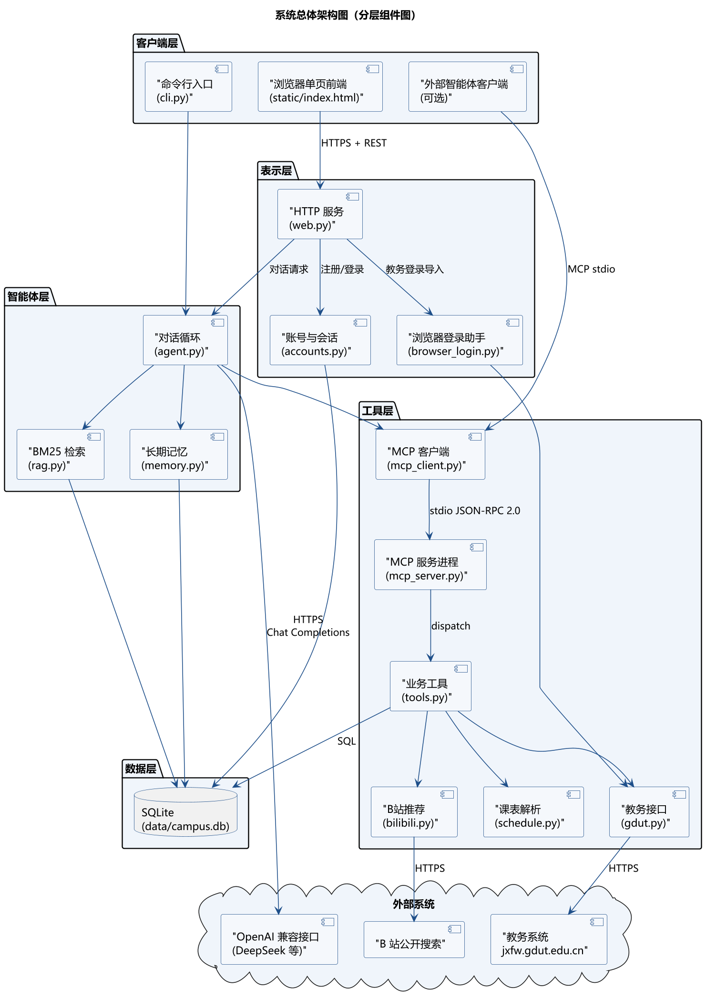
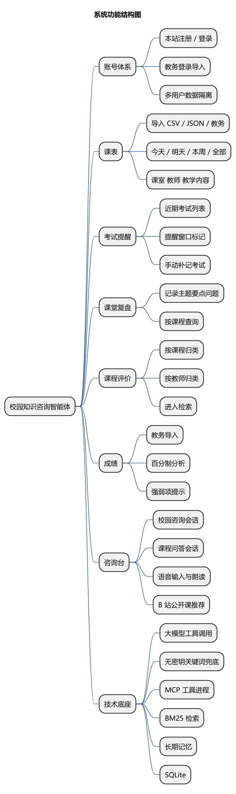
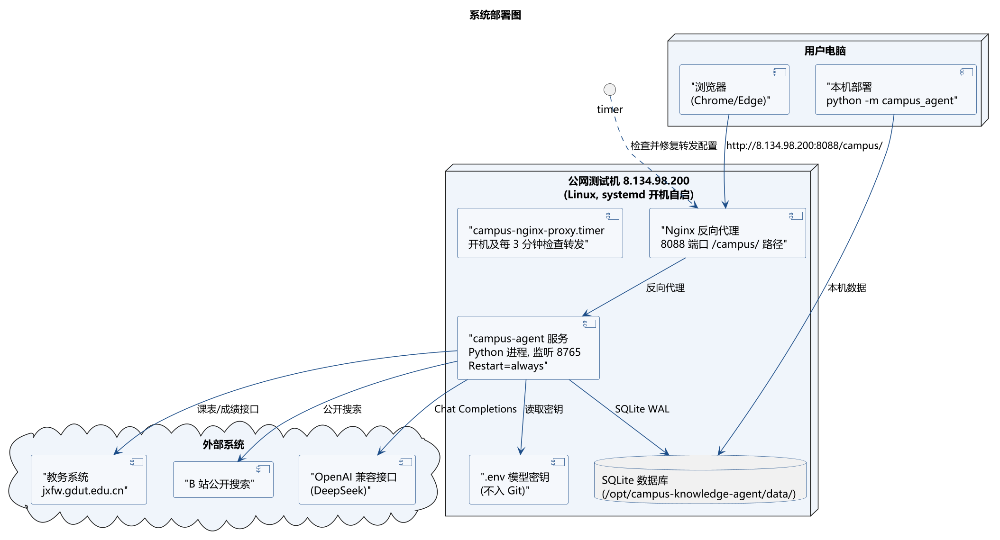
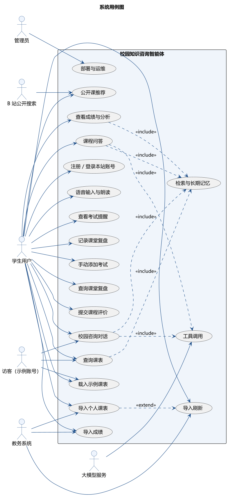
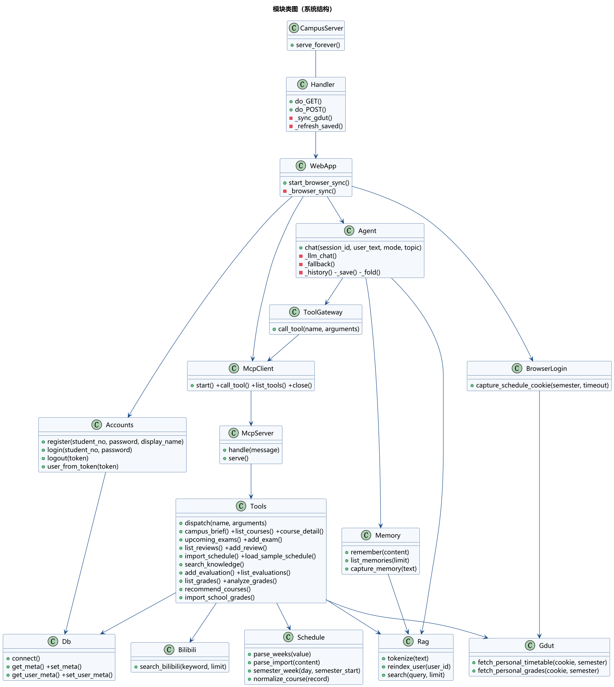
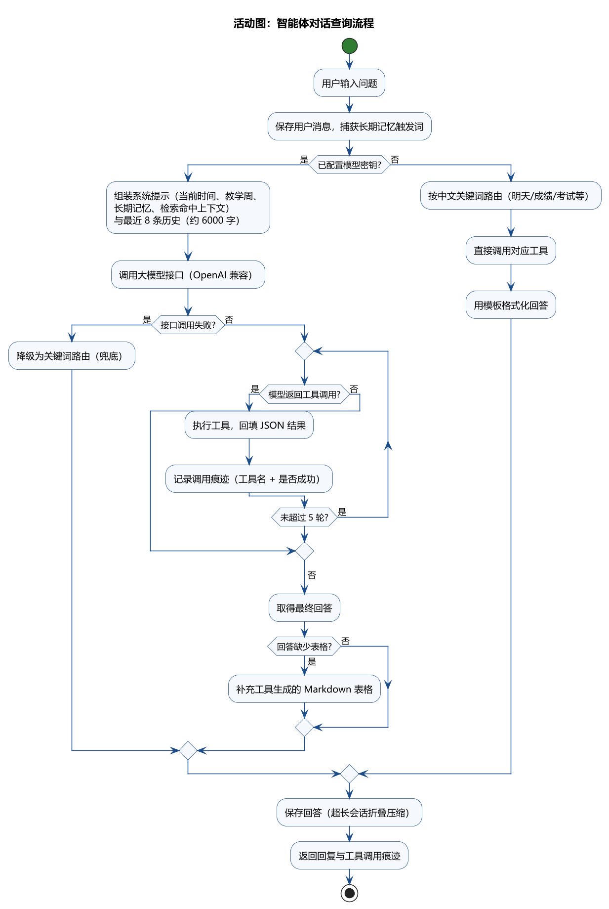
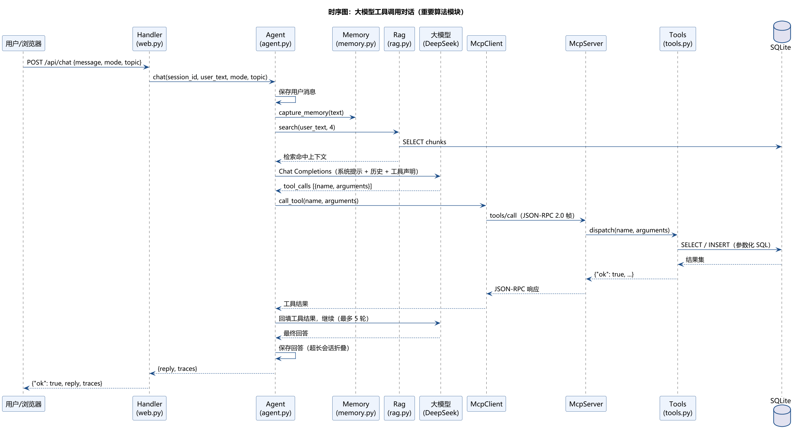
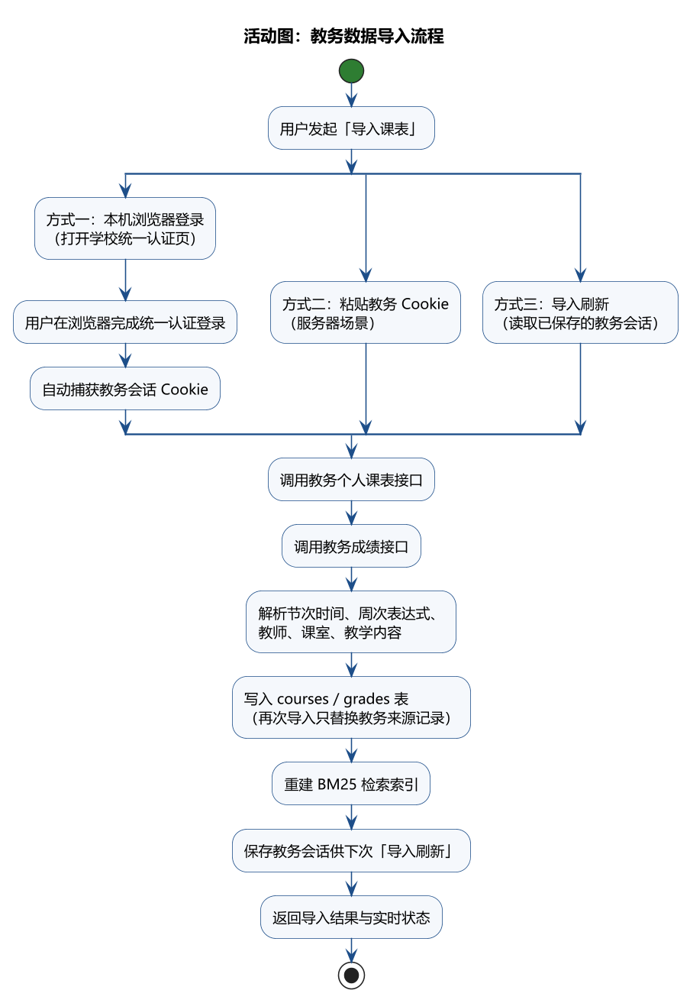
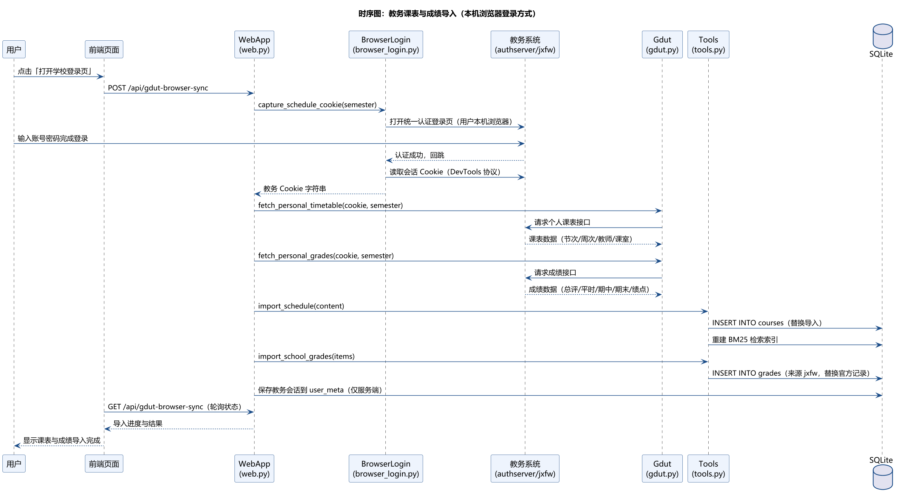
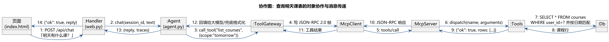

# 1. 引言

## 1.1 标识

| 项目 | 内容 |
| --- | --- |
| 系统名称 | 校园知识咨询智能体（Campus Knowledge Agent） |
| 系统版本 | v1.0（2026-11-08 发布） |
| 本文档名称 | 系统设计说明书 |
| 本文档版本 | v1.0，2026-11-22 编制 |
| 团队名称 | 杨富林与黎正阳的团队 |
| 团队成员 | 3124004072-杨富林、3124004060-黎正阳 |
| 所属课程 | 构建一个能说会做的智能体（广东工业大学 计算机学院 计科24级56班） |
| 源码仓库 | https://github.com/xiersg/campus-knowledge-agent |

## 1.2 系统概述

校园知识咨询智能体是面向广东工业大学学生的课表与学习智能体：用户注册本站账号、从教务导入个人课表与成绩后，即可用中文对话完成课表查询、考试提醒、课堂复盘、课程评价、成绩分析与 B 站公开课推荐。系统的核心设计原则是「只回答自己数据里的事实」——课室、教师、考试时间、教学内容与分数一律来自工具对本地数据库或教务系统的查询结果，模型不得凭空编造。

## 1.3 文档概述

### 1.3.1 编写目的

本文档在《需求分析文档》的基础上，描述校园知识咨询智能体的软件设计，包括体系结构、模块划分、模块详细设计、接口设计、运行设计、出错处理、安全保密与维护设计，作为编码、测试、部署与课程验收的依据。

### 1.3.2 文档结构说明

本文档依据 GB/T 8567-2006《计算机软件文档编制规范》中《软件（结构）设计说明（SSDD/SDD）》的文档框架编写，合并概要设计与详细设计两个层次：第 3 章为概要设计（体系结构、功能模块、部署、用例模型与系统结构类图），第 4 章起按「表示层 → 智能体层 → 工具层 → 检索与记忆 → 数据访问层」自顶向下展开详细设计，层次越深描述越具体。

### 1.3.3 预期读者

任课教师与助教（课程验收）、团队成员（开发与维护）、后续接手者（了解系统结构）。

## 1.4 术语与缩写

| 缩写/术语 | 定义 |
| --- | --- |
| Agent | 智能体，能理解中文问题、自主选择工具、执行动作并组织回答的程序 |
| MCP | Model Context Protocol，模型上下文协议（2024-11-05 版）；本系统工具以独立进程按该协议暴露 |
| LLM | Large Language Model，大语言模型；本系统通过 OpenAI 兼容接口调用 DeepSeek 等 |
| RAG | Retrieval-Augmented Generation，检索增强生成；本系统指 BM25 本地索引 + 检索上下文注入 |
| BM25 | 一种经典全文检索排序算法，本系统用于本地知识检索 |
| REST | Representational State Transfer，本系统网页与后端之间的接口风格 |
| JSON-RPC | 基于 JSON 的远程过程调用协议，MCP 消息的载体 |
| SQL | Structured Query Language，结构化查询语言 |
| SQLite | 轻量级嵌入式关系数据库，本系统的数据存储 |
| WAL | Write-Ahead Logging，SQLite 的预写日志模式，读写不互相阻塞 |
| PBKDF2 | Password-Based Key Derivation Function 2，密码派生函数；本系统用 PBKDF2-HMAC-SHA256 存密码哈希 |
| HMAC-SHA256 | 带密钥的哈希消息认证码（SHA-256），密码哈希的底层算法 |
| CSV | Comma-Separated Values，逗号分隔值文本，课表导入格式之一 |
| ORM | Object-Relational Mapping，对象关系映射；本系统不引入 ORM 框架，实体与库表的映射关系见《数据库设计说明书》第 4.4 节 |
| HTTP / HTTPS | 超文本传输协议及其安全版本 |
| Cookie | 浏览器端小段存储；本系统会话 Cookie 名为 campus_session |
| SPA | Single Page Application，单页应用；本系统前端为单个 index.html |
| stdio | 标准输入输出；MCP 工具进程与主进程之间的传输通道 |
| systemd | Linux 服务管理器；测试机上的服务托管方式 |
| Nginx | 反向代理服务器；测试机上把公网 8088 端口的 /campus/ 路径转发到本服务 |
| 教务 | 广东工业大学教务系统 jxfw.gdut.edu.cn |
| 复盘 | 对某一次课堂内容的记录（主题、要点、遗留问题） |

## 1.5 参考资料

- GB/T 8567-2006《计算机软件文档编制规范》；
- GB/T 9385-2008《计算机软件需求规格说明规范》；
- 《杨富林与黎正阳的团队_需求分析文档》v1.0（本仓库 docs/需求分析文档.md）；
- 课程第二次团队作业要求（原型设计+概要设计）：https://edu.cnblogs.com/campus/gdgy/Class56-Grade2024-CS/homework/16784 ；
- MCP 协议规范（2024-11-05 版）；
- OpenAI Chat Completions 接口规范；
- 项目源码：https://github.com/xiersg/campus-knowledge-agent 。

# 2. 设计目标与设计原则

## 2.1 设计目标

| 目标 | 说明 | 实现手段 |
| --- | --- | --- |
| 准确性 | 课室、教师、考试时间、成绩等事实性回答必须来自工具查询，绝不编造 | 工具结果回填模型；无模型时关键词路由直调工具；模型无工具调用时不给结论 |
| 可用性 | 未配置模型密钥、模型接口不可用时核心功能仍可用 | 关键词兜底路由；内置示例课表；全中文交互 |
| 可部署性 | 零依赖安装，单机可长期运行 | 仅用 Python 3.10+ 标准库；systemd 开机自启；SQLite 单文件 |
| 可维护性 | 模块职责单一，一处定义多处使用 | 分层架构；TOOL_SPECS 一份定义同时供模型声明与 MCP tools/list；网页/命令行/外部客户端共用同一工具层 |
| 安全性 | 多用户数据隔离，敏感信息不落库明文、不出接口 | user_id 隔离；PBKDF2 密码哈希；教务 Cookie 仅存服务端 |

## 2.2 设计原则

1. 分层与单一职责：表示层只做协议与会话，智能体层只做对话编排，工具层只做业务能力，数据层只做存储；每层只能调用下一层，禁止跨层访问。
2. 工具与界面解耦：全部业务能力封装为 16 个工具，通过 MCP 协议以独立进程提供；网页、命令行、外部智能体客户端共用同一套工具。
3. 降级可用：模型能力是增强而非依赖——无密钥或接口异常时自动降级为关键词路由，查询类功能完全离线可用。
4. 事实有据可查：每条回答下方展示本次调用的工具及成功状态（traces）；模型回答缺表格时自动补上工具生成的 Markdown 表格。
5. 安全默认：密码只存哈希；教务密码不保存；教务 Cookie 不出接口；SQL 全部参数化；请求体限长。
6. 数据即文件：SQLite 单文件存储，备份即复制文件，迁移用 SCHEMA 幂等建表 + 增量 ALTER。

## 2.3 设计约束

| 约束 | 内容 |
| --- | --- |
| 语言与依赖 | Python 3.10+，仅标准库（无第三方依赖），前端纯 HTML/CSS/JavaScript 无框架 |
| 存储 | SQLite（WAL 模式），单文件 data/campus.db |
| 运行环境 | Linux 测试机 8.134.98.200（systemd 托管）、用户本机 Windows/macOS |
| 外部接口 | 教务系统（课表、成绩）、B 站公开搜索、OpenAI 兼容模型接口（可选） |
| 明确不做 | 不做选课抢课、不调用「日在广工」小程序接口、不保存教务密码、成绩不允许手记、不做移动端 App |

# 3. 系统总体设计

## 3.1 系统体系结构

系统采用「客户端—表示—智能体—工具—数据」五层架构，外部系统通过工具层与智能体层接入：



各层职责与层间通信如下：

| 层次 | 组成 | 职责 | 对下接口 |
| --- | --- | --- | --- |
| 客户端层 | 浏览器单页前端、命令行入口、外部智能体客户端（可选） | 呈现界面、采集输入 | HTTPS REST / 直接调用 / MCP stdio |
| 表示层 | web.py（HTTP 服务）、accounts.py（账号）、browser_login.py（浏览器登录） | 路由分发、会话认证、教务同步编排 | 直接调用下层模块 |
| 智能体层 | agent.py（对话循环）、memory.py（长期记忆）、rag.py（BM25 检索） | 对话编排、上下文组装、降级兜底、记忆与检索 | MCP 客户端 → 工具层 |
| 工具层 | tools.py（16 个业务工具）、mcp_server.py / mcp_client.py、gdut.py、bilibili.py、schedule.py | 业务能力、MCP 协议服务、教务与 B 站接口、课表解析 | SQL → 数据层 |
| 数据层 | db.py、SQLite 数据库 | 存储与访问 | — |
| 外部系统 | 教务系统、B 站公开搜索、OpenAI 兼容接口 | 数据与模型能力来源 | — |

要点说明：

1. 智能体层不直接调用工具函数，而是通过 MCP 客户端以 JSON-RPC 帧驱动独立工具进程——这正是「工具以独立进程提供，外部智能体客户端同样可以接入」的架构基础。
2. 工具层与数据层之间只有 tools.py、rag.py、memory.py、accounts.py 四个模块持有数据库连接，其余模块一律不得直接访问 SQLite。
3. 外部系统只出现在工具层与智能体层：教务与 B 站由工具层访问，模型接口由智能体层访问。

## 3.2 技术选型说明

| 类别 | 选型 | 理由 |
| --- | --- | --- |
| 开发语言 | Python 3.10+（标准库） | 团队熟悉；标准库自带 HTTP、SQLite、JSON-RPC 所需能力，零依赖安装 |
| 数据存储 | SQLite（WAL） | 单机班级规模足够；单文件易备份；WAL 读写不互斥 |
| 检索 | 自研 BM25（单字+双字分词） | 中文无词典轻量分词；无第三方依赖；数据量小无需向量库 |
| 模型接口 | OpenAI Chat Completions 兼容（默认 DeepSeek） | 接口通用可替换；未配置时降级关键词路由 |
| 工具协议 | MCP（2024-11-05，stdio 传输） | 工具独立进程；网页/命令行/外部客户端共用；协议公开 |
| 前端 | 纯 HTML/CSS/JavaScript 单页 | 无构建链；随服务静态下发；便于部署 |
| 部署 | systemd + Nginx 反向代理 | 开机自启、崩溃自愈；与测试机上其他项目共用 443/8088 端口 |

## 3.3 系统功能模块划分



功能与实现模块的对应关系：

| 功能域 | 功能点 | 主要实现模块 |
| --- | --- | --- |
| 账号体系 | 本站注册/登录/退出、教务登录导入、导入刷新、多用户数据隔离 | accounts.py、web.py、browser_login.py、gdut.py |
| 课表 | CSV/JSON/教务导入、今天/明天/本周/全部查询、课室教师教学内容详情 | schedule.py、gdut.py、tools.py |
| 考试提醒 | 近期考试列表、提醒窗口标注、手动补记考试 | tools.py |
| 课堂复盘 | 记录主题/要点/问题、按课程查询、详情附最近复盘 | tools.py |
| 课程评价 | 按课程/按教师归类、1～5 星评分、进入检索 | tools.py、rag.py |
| 成绩 | 教务导入、百分制分析、强弱项提示 | gdut.py、tools.py |
| 咨询台 | 校园咨询会话、课程问答会话、语音输入与朗读、B 站公开课推荐 | agent.py、bilibili.py、index.html |
| 技术底座 | 大模型工具调用、无密钥关键词兜底、MCP 工具进程、BM25 检索、长期记忆、SQLite | agent.py、mcp_server.py、rag.py、memory.py、db.py |

## 3.4 运行环境与部署设计



| 环境 | 说明 |
| --- | --- |
| 公网测试机 | Linux（8.134.98.200），服务以系统用户 campusagent 运行在 /opt/campus-knowledge-agent，监听 8765 端口；systemd 单元 Restart=always 并开机自启；Nginx 将公网 8088 端口的 /campus/ 路径反代到 8765；campus-nginx-proxy.timer 在开机后及每 3 分钟检查一次，若同机其他项目的 Nginx 部署盖掉转发则自动补回 |
| 用户本机 | Windows/macOS + Python 3.10+，python -m campus_agent 启动，浏览器访问 http://127.0.0.1:8765 |
| 数据 | SQLite 单文件，测试机位于 /opt/campus-knowledge-agent/data/，本机位于项目 data/ 目录 |
| 密钥 | .env 文件单独放置、不入 Git；模型密钥仅服务端读取 |

## 3.5 系统用例模型

用用例图对需求进行建模，明确系统边界与参与者：



| 参与者 | 说明 | 关联用例 |
| --- | --- | --- |
| 学生用户 | 注册本站账号的广工学生 | 账号、课表、考试、复盘、评价、成绩、两种对话、推荐、语音 |
| 访客（示例账号） | 未注册的试用者 | 载入示例课表、查询课表、校园咨询对话 |
| 教务系统 | 外部系统，提供课表与成绩数据 | 导入课表、导入成绩、导入刷新 |
| 大模型服务 | 外部系统，提供对话生成与工具选择 | 工具调用（被校园咨询/课程问答包含） |
| B 站公开搜索 | 外部系统，提供公开课视频数据 | 公开课推荐 |
| 管理员 | 测试机维护者 | 部署与运维 |

## 3.6 系统结构类图

类图描述系统结构：模块类图表达各模块（类）之间的静态关系，数据实体类图表达持久化实体及其关联（实体类与库表的映射见《数据库设计说明书》第 4.4 节）。



模块类图要点：

1. WebApp（web.py 的 App 类）是表示层的装配点，持有 Agent、McpClient、Accounts 的引用，并负责教务同步（_sync_gdut / _refresh_saved / start_browser_sync）。
2. Agent 不直接依赖 Tools，而是依赖 ToolGateway 接口；ToolGateway 默认实现直接调用 dispatch（同进程模式，命令行使用），网页模式经 McpClient 走 MCP 进程。
3. Tools 是工具层的业务核心，聚合访问 Db、Rag、Gdut、Schedule、Bilibili；Memory 复用 Rag 的检索能力（长期记忆进入索引）。

# 4. 模块设计

本章按「表示层 → 智能体层 → 工具层 → 检索与记忆 → 数据访问层 → 账号与安全 → 浏览器登录助手」自顶向下描述，层次越深内容越具体。

## 4.1 表示层设计

### 4.1.1 网页前端（campus_agent/static/index.html）

前端为单页应用（纯 HTML/CSS/JavaScript，约 1090 行，无框架），视觉风格为浅蓝渐变玻璃拟态，主色 #1d4e89（深蓝）与 #4d92f0（亮蓝），响应式布局（900px 以下纵向排列）。前端不直接读写数据库，全部通过 REST 接口；登录状态由 HttpOnly Cookie（campus_session）自动携带；所有接口统一返回 {"ok": true/false, ...} 结构，前端统一处理失败提示。

页面结构：

| 区域 | 内容与交互规则 |
| --- | --- |
| 顶部横幅 | 项目标志、标题、登录按钮、当前账号显示；未登录时弹注册/登录框 |
| 导航栏 | 本周课表 ｜ 考试提醒 ｜ 课程评价 ｜ 咨询台，四个面板切换 |
| 课表看板（左侧，可折叠） | 星期（一～日）× 节次（12 节含时间刻度）网格；今天所在列高亮；上一周/下一周翻页（week offset）；点击课程格子弹出详情窗（时间、课室、教师、教学内容、最近复盘）；「今日/明日」按钮弹当日课表清单 |
| 考试提醒面板 | 列出近期考试/答辩（课程、时间、地点、倒计时天数）；进入提醒窗口（默认提前 7 天）的条目标注「该提醒了」；下方为教务导入的成绩列表；「成绩分析」按钮显示平均分、偏低课程（75 分以下）、较好课程（85 分以上）与文字结论 |
| 课程评价面板 | 提交表单（课程名联想、教师名联想、1～5 星、评语）；结果按「按课程」「按教师」两张表归类 |
| 咨询台（右侧） | 两套会话：校园咨询（一切校园事务）与课程问答（每门课独立会话，回答限定当前课程）；课程问答模式显示课程选择标签（按课表自动生成）；消息按 12 条一页分页，滚动到顶部自动加载更早记录；回答中的表格以 Markdown 风格渲染；每条回答下方显示工具调用痕迹（工具名+是否成功）；浏览器语音输入（Web Speech API）与朗读最近一条回答（speechSynthesis） |

### 4.1.2 HTTP 服务（web.py）

| 组成 | 说明 |
| --- | --- |
| CampusServer | ThreadingHTTPServer 子类，每请求一线程，支持班级规模并发 |
| Handler | BaseHTTPRequestHandler 子类，实现 do_GET / do_POST 路由分发；请求体上限 1 MB，JSON 严格校验 |
| App | 业务装配类：持有 Agent、McpClient 等；教务同步逻辑（_sync_gdut 粘贴 Cookie 导入、_refresh_saved 已存会话刷新、start_browser_sync 本机浏览器登录导入与状态轮询） |
| make_server(host, port, app) | 工厂函数，启动服务 |

路由表见第 5.1 节。

### 4.1.3 命令行入口（cli.py）

`python -m campus_agent.cli --demo` 在终端与智能体对话：复用同一 Agent 与 ToolGateway（进程内 dispatch，不经 MCP 进程），保证命令行与网页行为一致。支持 --demo 自动载入示例课表。

## 4.2 智能体层设计（agent.py）

### 4.2.1 对话循环处理流程



Agent.chat(session_id, user_text, mode, topic) 的处理规则：

| 步骤 | 规则 |
| --- | --- |
| 输入 | mode 取值 campus（校园咨询）或 knowledge（课程问答），非法值回落到 campus；knowledge 模式下 topic 为课程名（截断 40 字），系统提示把回答锁定在该课程 |
| 保存与记忆 | 先保存用户消息；capture_memory 检查长期记忆触发词（记住/请记得/别忘了/以后都/我喜欢/我不喜欢） |
| 有密钥路径 | 组装系统提示（当前时间、星期、教学周、最多 8 条长期记忆、最多 4 条检索命中）+ 最近 8 条历史（每条截断 2000 字，合计约 6000 字预算）→ 调用模型，最多 5 轮工具调用；每轮把工具 JSON 结果回填；工具结果超过 2000 字截断；最终回答缺表格时自动补上工具生成的 Markdown 表格 |
| 无密钥/异常路径 | 模型接口异常（URLError/TimeoutError/RuntimeError/JSONDecodeError）或无密钥时降级 _fallback：按中文关键词路由直调工具（见 4.2.3），并注明「已改用本机资料直接回答」 |
| 输出 | 返回 {reply, traces, user_message_id, assistant_message_id}；traces 为本次调用的工具名、参数与成功状态 |

### 4.2.2 大模型工具调用对话时序



该时序是本系统最重要的算法模块：模型在系统提示的约束下选择工具，工具结果以 role=tool 消息回填，模型在下一轮基于真实数据组织回答——「事实来自工具」的闭环由此保证。

### 4.2.3 关键词兜底路由

无密钥或接口异常时，_fallback 按中文关键词直接路由到工具（下表为主要规则，命中即调用并套用格式化模板）：

| 关键词/模式 | 行为 |
| --- | --- |
| 文本形如表格（含 CSV 表头/竖线）或含「导入」 | import_schedule 导入课表；提示 CSV 表头格式 |
| 「今天」「明天」「课」「课表」「课程」 | list_courses / course_detail |
| 「考试」「答辩」「提醒」 | upcoming_exams / add_exam |
| 「复盘」「笔记」「讲了什么」 | list_reviews / add_review |
| 「成绩」「分数」「绩点」「分析」 | list_grades / analyze_grades |
| 「评价」 | add_evaluation / list_evaluations |
| 「记住」「记得」 | 写入长期记忆 |
| 「推荐」「公开课」 | recommend_courses（课程问答模式下围绕当前课程） |
| 「简报」/打招呼 | campus_brief |

兜底路径与模型路径共用同一批格式化函数（_format_courses、_format_exams 等），保证两种路径输出风格一致。

### 4.2.4 历史裁剪与会话折叠

| 机制 | 规则 |
| --- | --- |
| 分页 | list_chat(session_id, before, limit)：每页 12 条，倒序取，滚动到顶加载更早 |
| 裁剪 | trim_history + _fit_messages：送入模型的历史最多 8 条、总字数约 6000 字上限 |
| 折叠 | compact_chat：同一会话超过 36 条时，最早的原文压缩成一条长期记忆（进入检索），原文删除，保留最近 18 条 |

## 4.3 工具层设计

### 4.3.1 MCP 工具服务（mcp_server.py / mcp_client.py）

工具以独立进程提供，遵循 MCP（2024-11-05）stdio 传输：

| 项目 | 设计 |
| --- | --- |
| 帧格式 | Content-Length 头 + JSON 文本体（read_exact 定长读取 / write_message 定长写出） |
| 协议 | JSON-RPC 2.0；支持 initialize、ping、tools/list、tools/call 四个方法（handle 分派） |
| 工具清单 | tools/list 返回 TOOL_SPECS（16 个工具的名称、描述与 JSON Schema 参数）；同一份定义也作为模型的 tools 声明（_openai_tool 转换），一处定义两处使用 |
| 多用户 | tools/call 的参数由客户端注入 user_id；服务端用 contextvar 传递当前用户，工具层按该用户读写数据 |
| 客户端 | McpClient 以子进程启动服务进程，封装 start / list_tools / call_tool / close；网页与命令行共用 |

### 4.3.2 业务工具设计（tools.py）

全部 16 个业务工具（dispatch 统一分派）：

| 工具 | 参数 | 返回 | 写操作 |
| --- | --- | --- | --- |
| campus_brief | 无 | 当前学期、今天明天的课、应提醒的考试、当前教学周 | 否 |
| list_courses | scope(today/tomorrow/week/all)、keyword、week_offset | 课程列表（含时间、教师、课室、周次、教学内容） | 否 |
| course_detail | name（课程名，可部分匹配） | 教师、课室、时间、教学内容 + 最近一次复盘 | 否 |
| upcoming_exams | within_days（默认 30） | 近期考试列表，标注是否进入提醒窗口 | 否 |
| add_exam | course_name、exam_at(YYYY-MM-DD HH:MM)、location、note、remind_days(默认 7) | 新增结果 | 是 |
| list_reviews / add_review | course_name、keyword、limit / course_name、session_date、topic、key_points、questions | 复盘列表 / 新增结果 | add 是 |
| import_schedule | content（CSV/JSON）、replace（默认整表替换） | 导入课程数、考试数、复盘数 | 是 |
| load_sample_schedule | 无 | 载入示例课表结果 | 是 |
| search_knowledge | query、limit(默认 4) | 课表/考试/复盘/评价/成绩/记忆的检索命中 | 否 |
| add_evaluation / list_evaluations | course_name、teacher、rating(1～5)、comment / keyword | 新增结果 / 按课程、按教师归类的评价列表 | add 是 |
| import_school_grades | items（教务成绩条目） | 导入条数；再次导入只替换教务来源记录 | 是 |
| list_grades / analyze_grades | keyword / 无 | 成绩列表 / 平均分、75 分以下弱项、85 分以上强项与结论 | 否 |
| recommend_courses | topic、limit(默认 5) | B 站视频标题、UP 主、播放量、链接 | 否 |

统一约束：所有工具做参数校验（范围、格式、必填），失败返回 {"ok": false, "error": ...}；智能体必须如实说明失败原因，不得假装完成。成绩只能由教务导入写入（来源标记 _source=jxfw），系统不提供任何手记成绩入口。

### 4.3.3 教务接口模块（gdut.py）

| 项目 | 设计 |
| --- | --- |
| 登录 | 统一认证 authserver.gdut.edu.cn 登录后取得教务会话 Cookie（Cookie 由调用方传入，模块不保存密码） |
| 课表接口 | fetch_personal_timetable(cookie, semester)：读取个人课表页面数据，rows_to_courses 解析为课程行（教师、课室、节次、周次、教学内容） |
| 成绩接口 | fetch_personal_grades(cookie, semester)：读取成绩接口（xskccjxx!getDataList.action），rows_to_grades 解析总评、平时、期中、期末、学分、绩点与分项分数 |
| 解析规则 | 节次时间表共 12 节（_clock）；周次表达式支持 1-16、1-8,10、1-16单（_weeks 展开为周列表）；学期代码 202601 表示 2026-2027 学年第一学期（semester_label） |
| 网络 | _open 统一处理请求与编码；_NoRedirect 拦截教务重定向以维持会话 |

### 4.3.4 教务导入时序





三种导入方式的差异只在前置认证环节：本机浏览器登录（capture_schedule_cookie 捕获 Cookie）、粘贴 Cookie（_sync_gdut）、导入刷新（_refresh_saved 读取已保存会话）；认证之后的课表读取、成绩读取、写入、索引重建流程完全一致。

### 4.3.5 B 站推荐模块（bilibili.py）

search_bilibili(keyword, limit)：请求 B 站公开搜索页，videos_from_payload 解析出标题、UP 主、播放量、链接；接口无结果时返回搜索页链接兜底（search_url）。课程问答模式下由 _topic_clause 将话题限定在当前课程。

### 4.3.6 课表解析模块（schedule.py）

| 项目 | 设计 |
| --- | --- |
| CSV 表头 | 课程,教师,课室,星期,开始时间,结束时间,周次,教学内容；星期可写「周一」或 1；parse_import 统一转 JSON 结构 |
| 周次表达式 | parse_weeks 支持 1-16、1-8,10、1-16单；compact_weeks 反向压缩为紧凑表示 |
| 时间 | parse_clock 归一化 HH:MM；split_time_range 拆分时间段 |
| 学期换算 | semester_week 按学期起始日算教学周；teaching_week_dates 给出教学周对应日期 |
| 考试时间 | parse_exam_at 解析并校验 YYYY-MM-DD HH:MM |

## 4.4 检索与记忆设计

### 4.4.1 BM25 检索（rag.py）

| 项目 | 设计 |
| --- | --- |
| 分词 | tokenize：中文按单字 + 相邻双字切词（无词典），英文与数字按整段切词 |
| 索引 | chunks 表存检索块（source 为课程/考试/复盘/评价/成绩/记忆，ref 为源行 id，text 为正文）；写操作后 reindex_user 全量重建该用户索引 |
| 打分 | _bm25 标准 BM25 公式（k1=1.5、b=0.75）；search(query, limit=4) 返回按分排序的命中 |
| 使用 | Agent 把命中作为「检索索引」注入系统提示；课程问答模式限定当前课程相关命中 |

### 4.4.2 长期记忆（memory.py）

| 项目 | 设计 |
| --- | --- |
| 写入 | capture_memory：句子含「记住/请记得/别忘了/以后都/我喜欢/我不喜欢」时写入；remember 供工具与折叠逻辑显式写入；上限 30 条 |
| 使用 | list_memories(8) 注入系统提示作为背景（并注明「课表事实以工具为准」）；记忆同时进入 BM25 索引可被检索 |

## 4.5 数据访问层设计（db.py）

| 项目 | 设计 |
| --- | --- |
| 连接 | connect()：打开 data/campus.db，PRAGMA journal_mode=WAL、foreign_keys=ON，executescript(SCHEMA) 幂等建表，缺失列自动 ALTER 补列（历史库迁移） |
| 表 | 12 张：meta、users、sessions、user_meta、courses、exams、reviews、messages、grades、evaluations、memories、chunks（详见《数据库设计说明书》） |
| 访问约定 | 全部 SQL 参数化；账号数据按 user_id 隔离；rows_as_dicts 把 sqlite3.Row 转为 dict 供上层使用 |
| 元数据 | meta 表存 semester_start、semester_name 等系统级配置；user_meta 表存每用户附加数据（如教务会话 Cookie） |

## 4.6 账号与安全模块（accounts.py）

| 项目 | 设计 |
| --- | --- |
| 注册 | register(student_no, password, display_name)：学号唯一；_check_password 校验强度（长度与字符类别）；_hash 生成随机盐（secrets）+ PBKDF2-HMAC-SHA256 120000 次迭代，只存哈希与盐 |
| 登录 | login 校验哈希后 _issue 签发 128 位随机令牌，写入 sessions 表（expires_at 14 天） |
| 会话 | user_from_token 按令牌与有效期还原用户；logout 删除令牌；Cookie 属性 HttpOnly、SameSite=Lax、14 天 |
| 示例账号 | id=1（student_no=sample），随机密码哈希，不能通过密码登录，供访客载入示例课表体验 |

## 4.7 浏览器登录助手（browser_login.py）

capture_schedule_cookie(semester, timeout=180, on_status)：本机场景下打开系统默认浏览器（Edge/Chrome）的教务统一认证页，用户登录后经 DevTools 协议（DevtoolsClient，WebSocket 控制台）读取教务会话 Cookie，供 gdut 模块导入课表与成绩。辅助函数：find_browser 定位浏览器、_free_port/_wait_port 管理调试端口、format_cookie_header 格式化 Cookie 头。

# 5. 接口设计

## 5.1 REST 接口

| 方法 | 路径 | 用途 | 认证 |
| --- | --- | --- | --- |
| GET | / | 返回单页前端 | 无 |
| GET | /api/health | 健康检查（是否配置了模型密钥） | 无 |
| GET | /api/me | 当前登录用户信息 | 会话 |
| POST | /api/register / /api/login / /api/logout | 注册 / 登录 / 退出 | 无 / 会话 |
| GET | /api/overview | 今日简报（今天明天的课 + 提醒） | 会话 |
| GET | /api/week?offset=n | 按教学周取课表（offset 翻周） | 会话 |
| GET | /api/messages?session_id=&before=&limit= | 分页取会话消息 | 会话 |
| POST | /api/chat | 对话（message、mode、topic、session_id） | 会话 |
| POST | /api/import | 导入 CSV/JSON 课表 | 会话 |
| POST | /api/sample | 载入示例课表 | 会话 |
| POST | /api/gdut-sync | 用粘贴的教务 Cookie 导入课表+成绩 | 会话 |
| POST | /api/gdut-refresh | 用已保存的教务会话刷新导入 | 会话 |
| POST | /api/gdut-browser-sync | 本机浏览器登录导入（轮询 GET 同名接口取状态） | 会话 |
| GET | /api/grades?keyword= | 成绩列表 | 会话 |
| GET | /api/grade-analysis | 成绩百分制分析 | 会话 |
| GET / POST | /api/evaluations | 评价列表 / 提交评价 | 会话 |

接口约定：统一响应结构 {"ok": true/false, ...}；请求体上限 1 MB；JSON 严格校验；会话由 Cookie campus_session 携带；教务 Cookie 只出现在请求中，任何响应都不返回。

对话接口请求/响应示例：

```text
POST /api/chat
{"message": "明天有什么课？", "mode": "campus", "topic": "", "session_id": "campus:5"}

响应：
{"ok": true, "reply": "明天（11月23日 周一）的课：\n| 时间 | 课程 | 教师 | 课室 |",
 "traces": [{"tool": "list_courses", "arguments": {"scope": "tomorrow"}, "ok": true}],
 "user_message_id": 41, "assistant_message_id": 42}
```

## 5.2 MCP 接口

| 项目 | 内容 |
| --- | --- |
| 传输 | stdio；Content-Length 帧 + JSON-RPC 2.0；协议版本 2024-11-05 |
| 方法 | initialize、ping、tools/list（返回 16 个工具的 JSON Schema）、tools/call |
| 调用约定 | tools/call 参数由客户端注入 user_id；服务端按当前用户执行；返回 {"ok":..., ...} 的 JSON 文本 |

帧示例：

```text
Content-Length: 87

{"jsonrpc":"2.0","id":1,"method":"tools/call","params":{"name":"list_courses","arguments":{"scope":"tomorrow","user_id":3}}}
```

## 5.3 外部系统接口

| 外部系统 | 接口 | 说明 |
| --- | --- | --- |
| 教务系统 | 统一认证登录、个人课表页面、成绩接口 xskccjxx!getDataList.action | 需要教务会话 Cookie；不保存教务密码 |
| B 站 | 公开搜索页 | 解析标题、UP 主、播放量、链接；无结果给搜索页链接 |
| 模型服务 | POST {base}/chat/completions | OpenAI 兼容；默认 DeepSeek；由 .env 配置 api_key、base_url、model |

## 5.4 对象协作与消息传递

协作图展示「查询明天课表」这一典型场景中对象之间的协作关系与消息传递（编号即消息顺序）：



# 6. 数据结构设计

数据结构设计详见《杨富林与黎正阳的团队_数据库设计说明书》，要点如下：

- 12 张表按用户隔离（user_id），系统级配置存 meta 表；
- 密码存 PBKDF2-HMAC-SHA256 哈希与随机盐；教务会话 Cookie 存 user_meta，仅服务端读取；
- 检索索引独立存 chunks 表，写操作后重建；
- 实体类与库表的映射关系见《数据库设计说明书》第 4.4 节。

# 7. 运行设计

## 7.1 运行模块组合

启动流程（python -m campus_agent → web.py:main）：

1. 读取 .env（load_dotenv）配置模型密钥；
2. db.connect() 建表/迁移，保证示例账号与学期元数据存在；
3. 启动 MCP 工具进程（McpClient.start）并完成 initialize；
4. make_server 启动 CampusServer，监听 0.0.0.0:8765（本机默认 127.0.0.1:8765）；
5. 本机模式尝试调用系统浏览器打开页面（start_browser_sync 仅在有浏览器时）。

## 7.2 运行控制

| 项目 | 说明 |
| --- | --- |
| systemd 单元 | deploy/campus-agent.service：以 campusagent 用户运行，Restart=always，WantedBy=multi-user.target（开机自启） |
| 反向代理 | deploy/nginx-campus.location：Nginx 把 /campus/ 转发到 127.0.0.1:8765 |
| 转发守护 | deploy/campus-nginx-proxy.timer + service：开机后及每 3 分钟检查一次，若同机珠宝项目的 Nginx 部署覆盖了转发配置则自动补回 |

## 7.3 运行时间

| 项目 | 设计 |
| --- | --- |
| 并发模型 | ThreadingHTTPServer 每请求一线程；SQLite WAL 模式读写不互斥；单机可支撑一个班级规模并发 |
| 上下文预算 | 送入模型的历史 ≤ 8 条、约 6000 字；工具结果回填截断 2000 字；单次模型请求 ≤ 约 12000 字 |
| 分页 | 消息每页 12 条；课表按教学周翻页；成绩/评价列表按需过滤 |
| 索引 | BM25 索引写操作后重建，单用户数据量（数千行）重建耗时毫秒级 |

# 8. 系统出错处理设计

| 出错类别 | 处理设计 |
| --- | --- |
| 用户输入错误 | 工具参数校验失败返回 {"ok": false, "error": 原因}；智能体如实转述原因并给出正确用法提示（如「考试时间请写成 YYYY-MM-DD HH:MM」） |
| 模型接口不可用 | 捕获 URLError/TimeoutError 等，自动降级关键词路由，并在回答开头注明「模型接口暂时不可用，已改用本机资料直接回答」 |
| 未配置模型密钥 | 不调用模型，直接关键词路由，核心查询全部可用 |
| 教务接口失败 | 登录失效、接口超时等情况如实告知用户；教务会话 Cookie 保留在 user_meta，用户可稍后用「导入刷新」重试 |
| B 站无结果 | 返回搜索页链接兜底 |
| 会话超长 | 自动折叠压缩（见 4.2.4），不会无限增长 |
| 服务崩溃 | systemd Restart=always 自动拉起；WAL 保证已提交数据不丢 |
| 工具结果无内容 | 模型不得编造，回答如实说明「没有查到相关记录」 |

# 9. 安全保密设计

| 类别 | 设计 |
| --- | --- |
| 身份认证 | 密码 PBKDF2-HMAC-SHA256 120000 次迭代 + 随机盐，只存哈希；示例账号不能密码登录 |
| 会话管理 | 128 位随机令牌存库；Cookie campus_session 为 HttpOnly、SameSite=Lax，有效期 14 天 |
| 数据隔离 | 所有业务表按 user_id 隔离；工具调用由 contextvar 传递当前用户；跨账号数据不可见 |
| 敏感数据 | 教务 Cookie 仅存服务端 user_meta，任何接口响应不返回；教务密码不保存；模型密钥存 .env 不入 Git |
| 注入防护 | 全部 SQL 参数化，无字符串拼接；请求体上限 1 MB；JSON 严格校验；教务数据解析使用标准库解析器 |
| 输入输出 | 前端对展示文本做转义，防止 XSS；回答中只含工具查询到的真实数据 |

# 10. 维护设计

## 10.1 代码组织

| 模块 | 职责 |
| --- | --- |
| campus_agent/web.py | HTTP 服务、路由、教务同步编排 |
| campus_agent/agent.py | 对话循环、模型调用、兜底路由、历史管理 |
| campus_agent/tools.py | 16 个业务工具、TOOL_SPECS、dispatch |
| campus_agent/mcp_server.py / mcp_client.py | MCP 服务进程 / 客户端 |
| campus_agent/rag.py / memory.py | BM25 检索 / 长期记忆 |
| campus_agent/gdut.py / bilibili.py / schedule.py | 教务 / B 站 / 课表解析 |
| campus_agent/accounts.py / browser_login.py / db.py / config.py / cli.py / identity.py | 账号 / 浏览器登录 / 数据访问 / 配置 / 命令行 / 当前用户上下文（ContextVar） |
| campus_agent/static/index.html | 单页前端 |
| deploy/ | systemd 单元与 Nginx 配置 |
| tests/ | 17 项单元测试 |

## 10.2 测试设计

`python -m unittest discover -s tests -v` 共 17 项，覆盖：课表解析与周次表达式、考试提醒与导入、周翻页、复盘往返、评价归类与检索、成绩分析与 B 站会话、教务成绩只替换官方记录、多用户隔离、HTTP 对话等（对应需求验收项 A1～A14）。

## 10.3 部署与升级

| 项目 | 说明 |
| --- | --- |
| 升级流程 | 更新代码 → systemctl restart campus-agent → 验证 /api/health 与页面 |
| 数据备份 | SQLite 单文件：停止服务或 WAL checkpoint 后直接复制 data/campus.db |
| 迁移 | SCHEMA 幂等建表 + PRAGMA 检查缺列后 ALTER 补列，老库自动平滑升级 |
| 配置 | .env 与数据库均在部署目录，不进 Git |

## 10.4 需求可追踪性

| 需求验收项（需求文档 A1～A14） | 本说明书对应章节 |
| --- | --- |
| A1 账号体系 / A12 多用户隔离 | 4.5、4.6、9 |
| A2 课表导入 / A3 教务接入 | 4.3.3、4.3.4、4.7 |
| A4 课表查询 / A5 考试提醒 / A6 课堂复盘 / A7 课程评价 / A8 成绩 | 4.1.1、4.3.2 |
| A9 课程问答 / A10 无密钥兜底 / A11 语音 | 4.1.1、4.2 |
| A13 上线运行 | 3.4、7.2 |
| A14 自动化测试 | 10.2 |
