# 杨富林与黎正阳的团队第二次团队作业——原型设计+概要设计

> 发布说明：本文图片共 15 张——12 张设计图在仓库 `docs/design/img/png/`，3 张原型截图在仓库 `docs/prototype/`，请在博客园编辑器上传后按对应文件名替换路径；图表在仓库中均有 PlantUML 源文件（`docs/design/puml/`）可复核。

| 项目 | 内容 |
| --- | --- |
| 作业所属课程 | 构建一个能说会做的智能体（广东工业大学 计算机学院 计科24级56班）<https://edu.cnblogs.com/campus/gdgy/Class56-Grade2024-CS> |
| 作业要求 | <https://edu.cnblogs.com/campus/gdgy/Class56-Grade2024-CS/homework/16784> |
| 作业的目标 | 在需求分析与 v1.0 产品的基础上完成软件设计阶段工作：① 用原型设计工具交付前台应用与后台管理的可交互原型，把需求变成可见、可点击、可评审的界面方案；② 从架构角度自顶向下完成概要设计——用用例图做需求分析、活动图描述业务流程、类图描述系统结构、时序图描述重要算法模块、协作图展示对象协作与消息传递，并给出 ER 图、关系数据模型与对象关系映射；③ 制定以周为单位的开发计划（含里程碑与产出）与成员分工，记录团队协作过程，将两份设计说明书与原型链接提交到团队仓库 |
| 团队名称 | 杨富林与黎正阳的团队 |
| 团队成员学号-名字 | 3124004072-杨富林、3124004060-黎正阳 |

---

## 1. 原型设计（40%）

### 1.1 原型工具与交付方式

本组原型采用**高保真 HTML 交互原型**交付：每个页面都是可直接在浏览器中打开、可点击交互的独立 HTML 文件（自包含、零依赖），页面视觉 1:1 复刻 v1.0 已上线产品的设计语言（浅蓝渐变玻璃拟态、主色 #1d4e89/#4d92f0），交互规则与 Axure/墨刀中的「交互说明 + 规则说明」等价，且所有页面与交互均可在墨刀中逐页重建。

选择这一形式的原因：

1. **原型即产品**：团队 v1.0 已上线（<http://8.134.98.200:443/>），原型与真实产品使用同一套视觉与交互规范，评审原型等于评审真实产品，避免「原型一套、实现另一套」；
2. **链接稳定可访问**：原型文件提交在团队 GitHub 仓库，任何老师/助教无需安装任何软件，点开链接即可操作（见 1.5 节）；
3. **交互可验证**：弹窗、标签切换、翻周、模拟对话、表单校验等交互都能真实点击验证，而不仅是静态画板。

### 1.2 前台应用原型

前台原型页面结构（与产品一致）：顶部横幅（标志、标题、登录、导入课表）→ 导航（本周课表｜考试提醒｜课程评价｜咨询台）→ 工作区（左侧课表看板 + 右侧咨询台）。

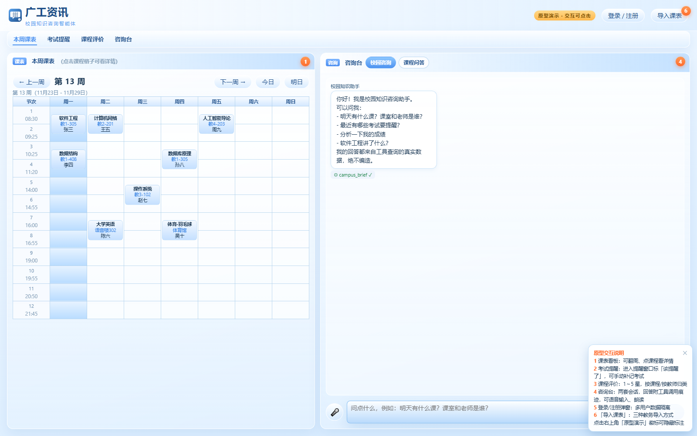

#### 1.2.1 页面与交互说明

| 区域 | 交互说明 |
| --- | --- |
| 顶部横幅 | 「登录 / 注册」打开登录弹窗（登录/注册两个标签切换）；「导入课表」打开教务导入弹窗 |
| 课表看板 | 星期（一～日）× 节次（12 节含时间刻度）网格；今天所在列高亮；「上一周 / 下一周」翻页，标题与日期范围同步变化；**点击任一课程格子**弹出课程详情窗（时间、教师、课室、教学内容 + 最近一次课堂复盘），详情窗内可一键切换到该课程的「课程问答」 |
| 考试提醒 | 列出近期考试/答辩（课程、时间、地点、倒计时天数）；进入提醒窗口（提前 7 天）的条目标注「该提醒了」；「添加考试」弹窗可补记考试（时间格式校验 YYYY-MM-DD HH:MM）；下方为教务导入的成绩列表 |
| 课程评价 | 课程名、教师名自动联想（来自课表）；1～5 星评分；提交后按「按课程」「按教师」两张表归类展示 |
| 咨询台 | 「校园咨询 / 课程问答」两套会话标签；课程问答模式显示课表课程选择标签，回答限定当前课程；发送消息后模拟智能体回复（表格渲染、回答下方展示工具调用痕迹「⚙ 工具名 ✓」）；支持语音输入（🎤 按钮，模拟 Web Speech API） |

#### 1.2.2 规则说明（重要业务规则）

| 编号 | 规则 |
| --- | --- |
| R1 | 所有事实性回答（课室、教师、时间、分数）必须来自工具查询结果，模型不得编造；每条回答下方显示工具调用痕迹 |
| R2 | 成绩只由教务导入写入，系统不提供手记成绩入口 |
| R3 | 考试进入「提前 remind_days 天」提醒窗口时标注「该提醒了」 |
| R4 | 课程问答每门课独立会话，回答限定在当前课程范围，避免串课 |
| R5 | 未配置模型密钥或接口失败时自动降级为关键词路由，核心查询仍可用 |
| R6 | 会话消息分页展示（每页 12 条），滚动到顶加载更早记录 |

### 1.3 后台管理原型

后台管理是本次作业**新设计的原型**（产品 v1.0 无管理界面，规划于 v1.1 迭代实现），供测试机维护者（管理员）使用，包含六个模块：仪表盘、用户管理、模型与密钥、检索索引、服务监控、系统设置。

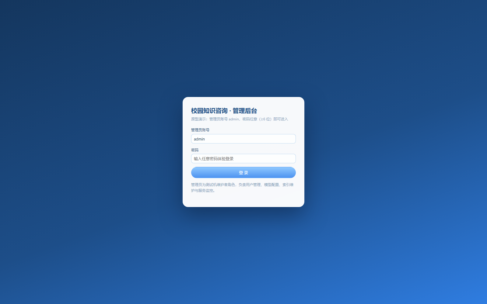

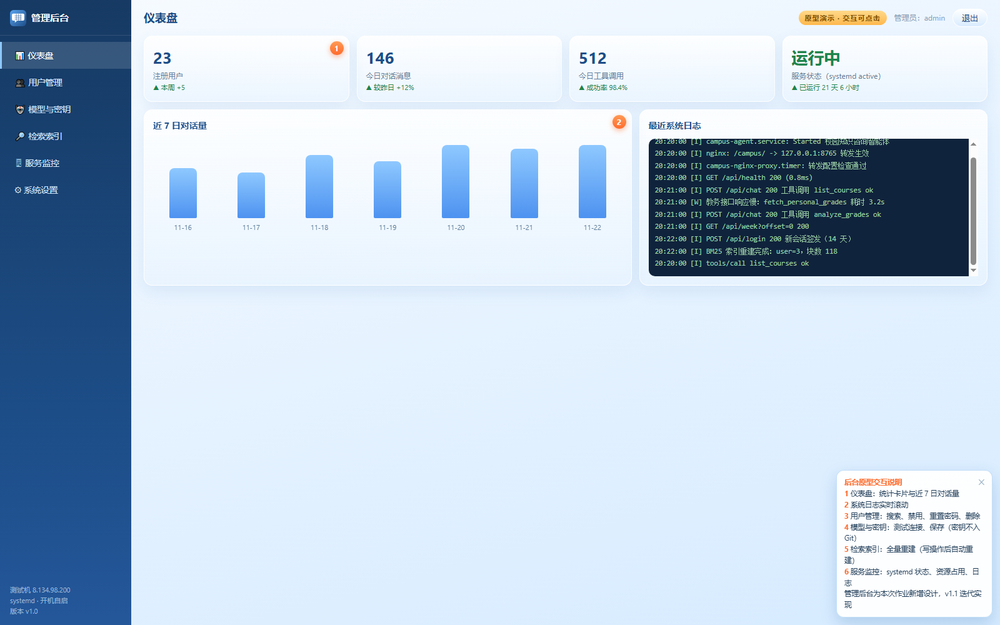

#### 1.3.1 模块与交互说明

| 模块 | 交互与功能说明 |
| --- | --- |
| 仪表盘 | 统计卡片（注册用户、今日对话、工具调用、服务状态）+ 近 7 日对话量柱状图 + 系统日志实时滚动 |
| 用户管理 | 按学号/姓名搜索；每个用户可重置密码、禁用/启用、删除（删除需二次确认，同时清理其课表/对话/记忆） |
| 模型与密钥 | 配置 API Key、Base URL、模型；「测试连接」模拟连通性测试；密钥只存服务端 .env、不入 Git、不展示明文 |
| 检索索引 | 按用户展示 BM25 索引块数与最近重建时间；「全量重建索引」带进度条；写操作后索引自动重建 |
| 服务监控 | systemd 服务状态（active、开机自启）、运行时长、CPU/内存占用条、服务日志滚动展示 |
| 系统设置 | 学期起始日、学期名称、会话有效期、消息分页大小、长期记忆上限；数据备份（SQLite 单文件复制） |

#### 1.3.2 规则说明

| 编号 | 规则 |
| --- | --- |
| A1 | 管理员登录后管理范围覆盖全部用户数据，操作留日志 |
| A2 | 密钥类配置只可修改不可回显明文 |
| A3 | 禁用用户后其会话令牌立即失效 |
| A4 | 删除用户为级联删除：课表、对话、记忆、检索块一并清理 |

### 1.4 原型的重要突出特点

1. **「回答有据可查」可视化**：每条智能体回答下方直接展示本次调用的工具名与成功状态（⚙ list_courses ✓），把「只回答真实数据」的核心原则做成了界面规则，用户和评审者一眼可见；
2. **两套会话、一门课一套问答**：校园咨询与课程问答分模式，课程问答按课表自动生成课程标签，回答锁定当前课程，从交互上杜绝「串课」；
3. **教务导入三种方式全覆盖**：本机浏览器登录 / 粘贴 Cookie / 导入刷新，覆盖本机与服务器两种部署形态，与真实产品一致；
4. **后台管理原型的「可运维性」**：不是摆设——仪表盘、索引重建、systemd 监控与日志直接对应部署真实项（`deploy/` 下的服务单元），v1.1 可按原型直接开发；
5. **原型内置交互标注**：页面上的橙色编号（①②③…）配合右下角「原型交互说明」面板，相当于 Axure 的标注层，方便评审逐点核对。

### 1.5 原型展示在线链接

| 原型 | 在线预览链接 |
| --- | --- |
| 前台应用原型 | <https://htmlpreview.github.io/?https://github.com/xiersg/campus-knowledge-agent/blob/main/docs/prototype/index.html> |
| 后台管理原型 | <https://htmlpreview.github.io/?https://github.com/xiersg/campus-knowledge-agent/blob/main/docs/prototype/admin.html#in>（#in 自动进入管理员视角；去掉 #in 可看登录页） |

仓库路径：`docs/prototype/index.html`、`docs/prototype/admin.html`（下载后双击即可本地打开，无任何依赖）。

---

## 2. 概要设计（40%）

### 2.1 系统总体架构

系统采用「客户端—表示—智能体—工具—数据」五层架构：表示层只做协议与会话；智能体层做对话编排与降级兜底；工具层以独立 MCP 进程提供 16 个业务工具；数据层为 SQLite 单文件。层间只允许自上而下调用，禁止跨层访问。外部系统（教务、B 站、模型接口）只出现在工具层与智能体层。

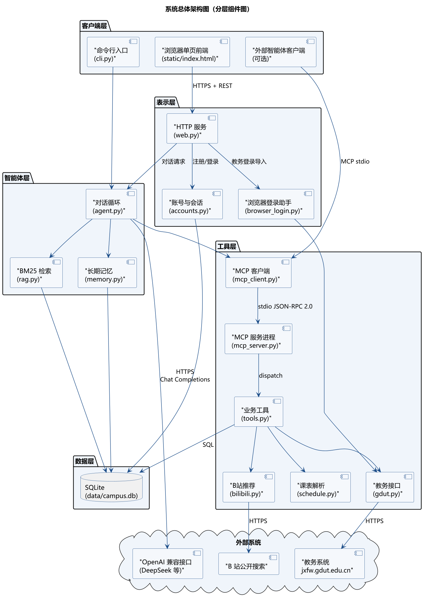

### 2.2 功能模块划分

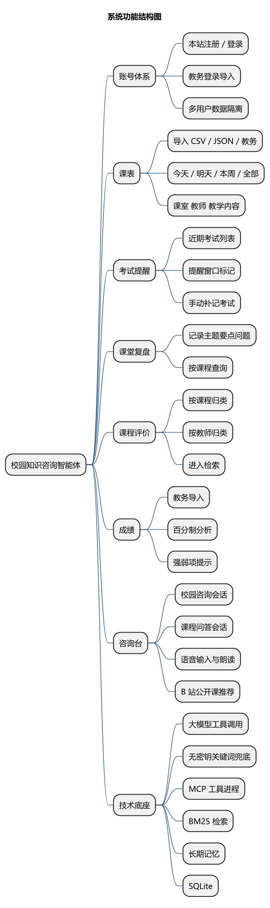

八大功能域：账号体系、课表、考试提醒、课堂复盘、课程评价、成绩、咨询台、技术底座。功能域与实现模块的对应关系见《系统设计说明书》3.3 节。

### 2.3 运行与部署设计

公网测试机 8.134.98.200：systemd 托管（开机自启、崩溃自愈），Nginx 把 8088 端口的 /campus/ 反代到服务端口 8765，转发守护 timer 每 3 分钟自检修复；用户本机可直接 `python -m campus_agent` 运行。

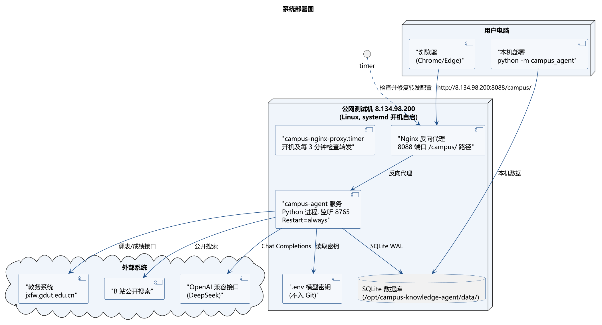

### 2.4 UML 设计

#### 2.4.1 用例图（需求分析）

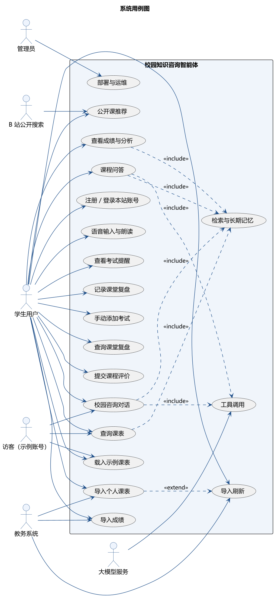

参与者：学生用户、访客（示例账号）、教务系统、大模型服务、B 站公开搜索、管理员。核心用例包括：导入课表/成绩/刷新、查询课表、考试提醒、课堂复盘、课程评价、成绩分析、校园咨询对话、课程问答、公开课推荐、语音输入与朗读；校园咨询与课程问答包含「工具调用」与「检索与长期记忆」，保证「对话必须有工具支撑」。

#### 2.4.2 活动图（业务流程）

智能体对话查询流程（重要业务流程）：有模型密钥时走「提示词组装 → 模型调用 → 工具调用回填（≤5 轮）→ 补表格」路径；无密钥或接口异常自动降级为关键词路由直调工具——两条路径都保证事实来自工具。

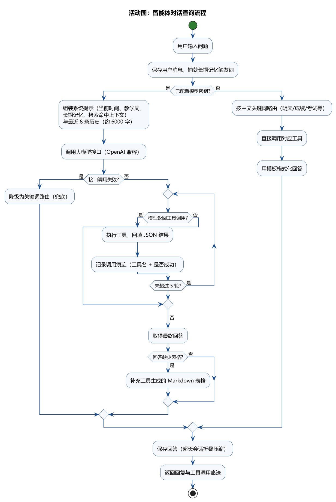

教务数据导入流程：三种认证方式（本机浏览器登录 / 粘贴 Cookie / 导入刷新）汇合后统一走「读课表 → 读成绩 → 写入（替换教务来源记录）→ 重建索引」流程。

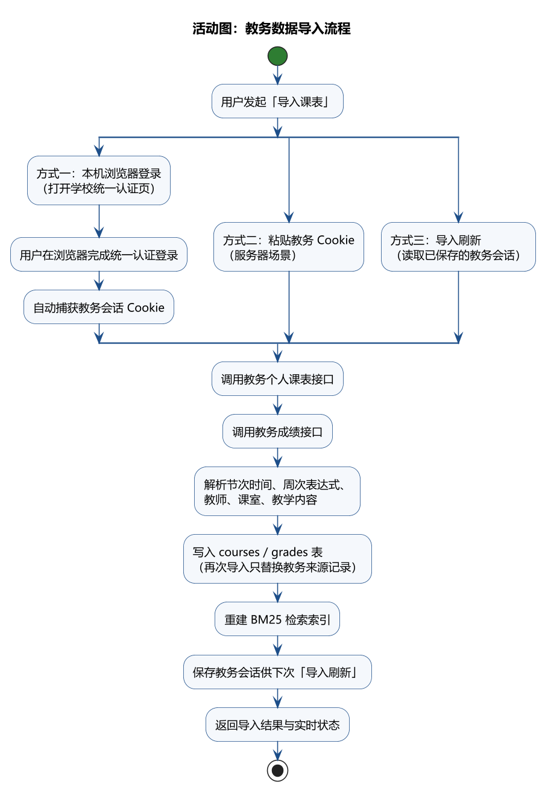

#### 2.4.3 类图（系统结构）

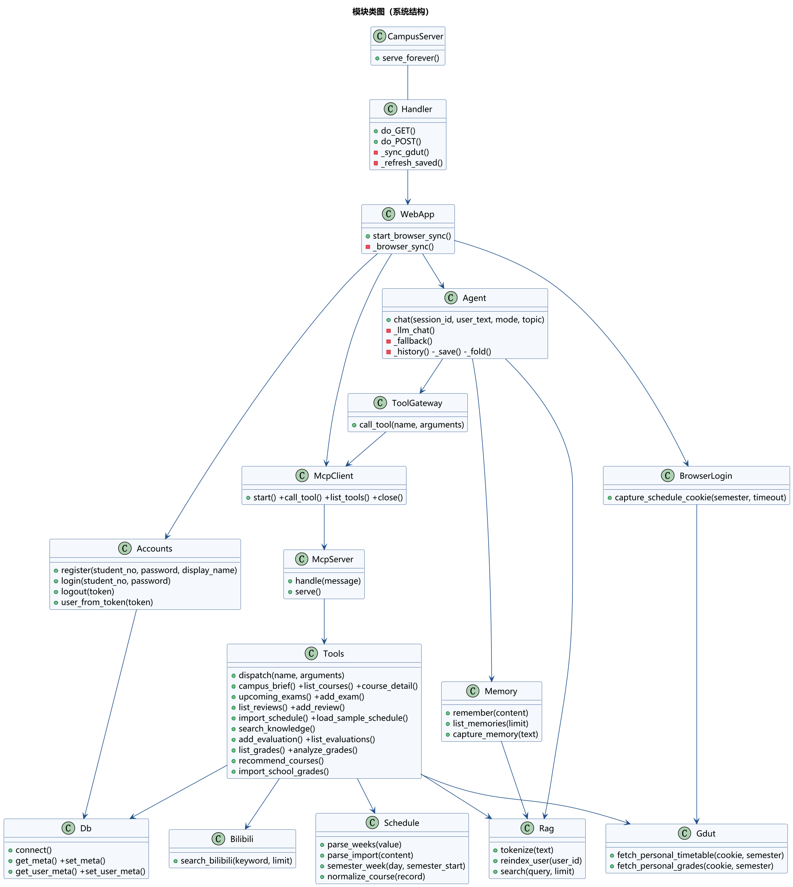

要点：Agent 依赖 ToolGateway 抽象（同进程直调 dispatch 或经 McpClient 走 MCP 进程），Tools 聚合访问 Db/Rag/Gdut/Schedule/Bilibili；网页、命令行共用同一套工具层。

#### 2.4.4 时序图（重要算法模块）

大模型工具调用对话是本系统最重要的算法模块：模型基于系统提示选择工具，工具结果以 role=tool 回填，模型下一轮基于真实数据组织回答，「事实来自工具」的闭环由此保证。

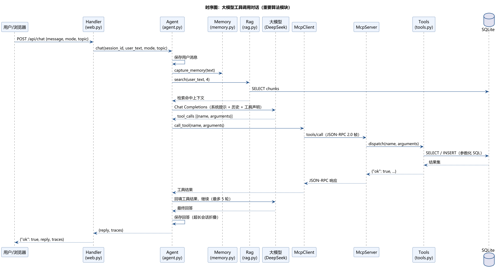

教务导入时序（本机浏览器登录方式）：DevTools 协议捕获教务 Cookie → 课表/成绩接口 → 写入 SQLite → 重建索引。

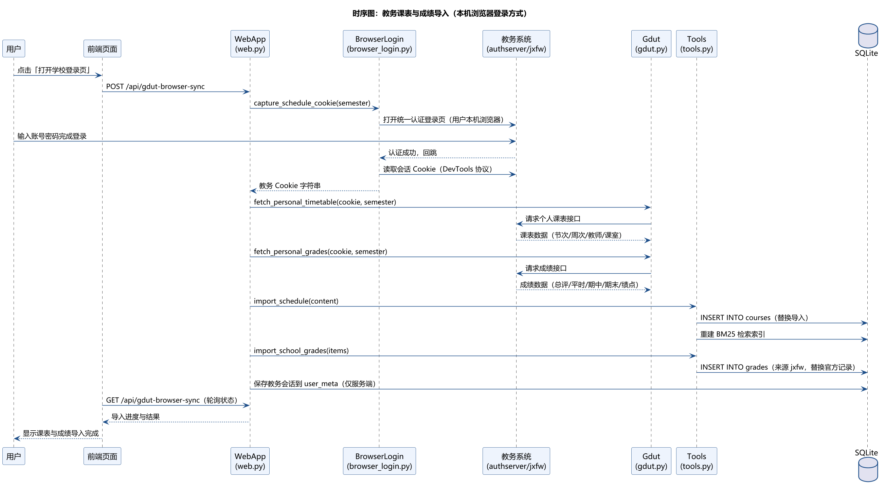

#### 2.4.5 协作图（对象协作与消息传递）

以「查询明天课表」为例展示对象协作关系与消息传递顺序（编号 1～14）：

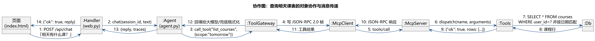

### 2.5 数据库设计

#### 2.5.1 ER 图

12 个实体：用户（users）为核心，与会话、用户附加数据、课程、考试、复盘、评价、成绩、消息、记忆、检索块构成 1:N 联系；系统元数据（meta）独立。

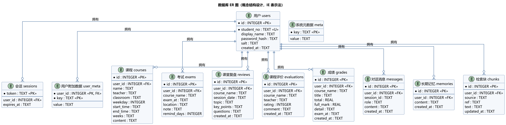

#### 2.5.2 关系数据模型

| 表 | 主键 | 关键约束 | 说明 |
| --- | --- | --- | --- |
| users | id | student_no UNIQUE | 密码只存 PBKDF2 哈希+盐 |
| sessions | token | — | 会话令牌，14 天有效 |
| user_meta | (user_id, key) | — | 教务 Cookie、学期设置等键值对 |
| courses | id | user_id NOT NULL | 课表（节次、周次表达式、教学内容） |
| exams | id | remind_days DEFAULT 7 | 考试/答辩提醒 |
| reviews | id | — | 课堂复盘（主题、要点、问题） |
| evaluations | id | rating 1～5 | 课程评价 |
| grades | id | full_mark DEFAULT 100 | 成绩（仅教务导入写入） |
| messages | id | session_id 分会话 | 对话消息，分页与折叠 |
| memories | id | 上限 30 条 | 长期记忆 |
| chunks | id | source 枚举 | BM25 检索块，写操作后重建 |
| meta | key | — | 系统级学期配置 |

全部模式满足 3NF；完整字段级定义、范式分析、索引与数据字典见《数据库设计说明书》第 4～6 章。

#### 2.5.3 对象关系映射（ORM）

本系统受「仅用标准库」约束不引入 ORM 框架：数据访问层用 sqlite3.Row 读取、统一转为 dict，字段名即列名；工具层与网页层之间以 JSON 对象传递实体。实体类视图：

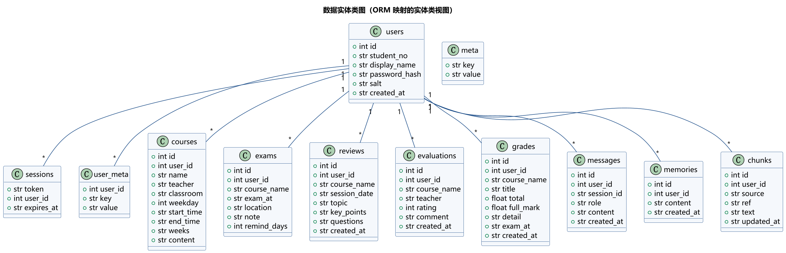

| 库表 | Python 表示 | 读写模块 |
| --- | --- | --- |
| users / sessions | dict | accounts.py、web.py |
| user_meta | dict | web.py、tools.py、agent.py |
| courses / exams / reviews / evaluations / grades | dict | tools.py、rag.py、agent.py |
| messages | dict | agent.py、web.py |
| memories | dict | memory.py、rag.py |
| chunks | dict | rag.py |
| meta | dict | db.py、tools.py |

---

## 3. 团队协作记录（20%）

### 3.1 预期开发计划时间安排（每周）

| 周次 | 时间 | 里程碑 | 主要工作 | 产出 |
| --- | --- | --- | --- | --- |
| 第 13 周 | 2026-11-23 ～ 11-29 | 设计阶段交付 | 系统设计说明书与数据库设计说明书定稿；前台+后台原型定稿并发布在线链接；博客发布 | 两份 PDF、原型链接、本次博客 |
| 第 14 周 | 2026-11-30 ～ 12-06 | 后台管理 v1.1 开发 | 按后台原型实现用户管理、模型与密钥配置、检索索引管理、服务监控；补充对应单元测试 | 后台管理功能上线、测试报告 |
| 第 15 周 | 2026-12-07 ～ 12-13 | 测试与加固 | 全流程回归测试；安全加固（密钥回显、会话失效验证）；性能压测（班级规模并发）；文档与需求一致性修订 | 测试报告、修订版文档 |
| 第 16 周 | 2026-12-14 ～ 12-20 | 答辩准备与验收 | 答辩 PPT、演示视频、上线检查（公网可访问、开机自启）；按验收标准 A1～A14 逐项自查 | 答辩材料、验收清单 |

### 3.2 预期开发计划分工安排

| 角色 | 成员 | 负责的详细开发部分 |
| --- | --- | --- |
| 项目经理 / 后端架构 | 杨富林（3124004072） | 总体架构与模块划分；智能体对话循环（agent.py）；MCP 工具层（tools.py / mcp_server.py / mcp_client.py）；数据库与检索（db.py / rag.py / memory.py）；教务接口（gdut.py）；测试机部署（systemd / Nginx）；系统设计与数据库设计说明书主笔；后台管理原型 |
| 前端 / UI / 测试 | 黎正阳（3124004060） | 网页前端（static/index.html）；HTTP 服务与账号接入（web.py / accounts.py / browser_login.py）；接口联调；单元测试（tests/）；前台应用原型；博客整理与发布；文档交叉评审 |

### 3.3 本次作业协作过程记录

| 时间 | 协作内容 | 参与 |
| --- | --- | --- |
| 11-20 | 解读第二次作业要求，梳理「原型 40% + 概要设计 40% + 协作 20%」的交付清单；确定原型交付形式与 UML 图清单 | 杨富林、黎正阳 |
| 11-21 | 复核需求分析文档与 v1.0 代码，核对 12 张数据表字段与 16 个工具签名，作为设计文档的事实基线；绘制架构/部署/功能结构图 | 杨富林、黎正阳 |
| 11-22 | 杨富林主笔《系统设计说明书》《数据库设计说明书》，绘制用例/活动/类/时序/协作/ER 共 12 张图；黎正阳制作前台与后台管理原型、整理交互与规则说明 | 杨富林、黎正阳 |
| 11-23 | 交叉评审（文档与代码逐项核对、原型逐点点击验证）；修订后由黎正阳发布博客，文档与原型提交团队仓库 | 杨富林、黎正阳 |

协作方式：代码与文档全部托管在团队 GitHub 仓库 <https://github.com/xiersg/campus-knowledge-agent>（Issues 记录任务、分支开发、PR 合入 main）；设计图源文件（PlantUML）随文档一起入库，任何一人都可重新生成全部图表，保证「图与代码一致、图与文档一致」。两位成员在 GitHub 上均有持续提交记录（v0.1～v1.0 迭代及本次作业的文档提交）。

### 3.4 项目管理平台

使用 GitHub 作为项目管理平台：Issues 拆解任务（如「绘制 ER 图」「后台原型-用户管理页」）、提交信息关联任务、PR 评审后合入。设计文档与原型均在仓库可追溯版本历史。

---

## 4. 原型设计展示（链接汇总）

- 前台应用原型：<https://htmlpreview.github.io/?https://github.com/xiersg/campus-knowledge-agent/blob/main/docs/prototype/index.html>
- 后台管理原型（管理员视角）：<https://htmlpreview.github.io/?https://github.com/xiersg/campus-knowledge-agent/blob/main/docs/prototype/admin.html#in>
- 后台管理原型（登录页）：<https://htmlpreview.github.io/?https://github.com/xiersg/campus-knowledge-agent/blob/main/docs/prototype/admin.html>
- 已上线产品（原型即产品）：<http://8.134.98.200:443/>

## 5. 后端设计展示

全部设计图（架构图、部署图、功能结构图、用例图、活动图×2、类图、时序图×2、协作图、ER 图、实体类图，共 12 张）见第 2 章，均以高分辨率 PNG 呈现，图源（PlantUML）在仓库 `docs/design/puml/`，可由任何成员一键重新生成，便于助教放大核对。

---

## 6. 仓库与文档下载

| 项目 | 链接 |
| --- | --- |
| GitHub 团队仓库 | <https://github.com/xiersg/campus-knowledge-agent> |
| 杨富林与黎正阳的团队_系统设计说明书.pdf | <https://raw.githubusercontent.com/xiersg/campus-knowledge-agent/main/docs/%E6%9D%A8%E5%AF%8C%E6%9E%97%E4%B8%8E%E9%BB%8E%E6%AD%A3%E9%98%B3%E7%9A%84%E5%9B%A2%E9%98%9F_%E7%B3%BB%E7%BB%9F%E8%AE%BE%E8%AE%A1%E8%AF%B4%E6%98%8E%E4%B9%A6.pdf> |
| 杨富林与黎正阳的团队_数据库设计说明书.pdf | <https://raw.githubusercontent.com/xiersg/campus-knowledge-agent/main/docs/%E6%9D%A8%E5%AF%8C%E6%9E%97%E4%B8%8E%E9%BB%8E%E6%AD%A3%E9%98%B3%E7%9A%84%E5%9B%A2%E9%98%9F_%E6%95%B0%E6%8D%AE%E5%BA%93%E8%AE%BE%E8%AE%A1%E8%AF%B4%E6%98%8E%E4%B9%A6.pdf> |
| 原型在线预览链接 | 见第 4 节 |

---

**结语**：本次作业我们把「要做什么」（需求分析）落实为「怎么做」（设计）：12 张 UML/ER 图自顶向下描述系统，两份国标规范的设计说明书逐层细化到函数与字段级，前台+后台原型可点击可验证，并且每一张图、每一个字段都来自真实代码与真实产品——设计与实现一一对应，随时可接受老师与助教的上线核对。
